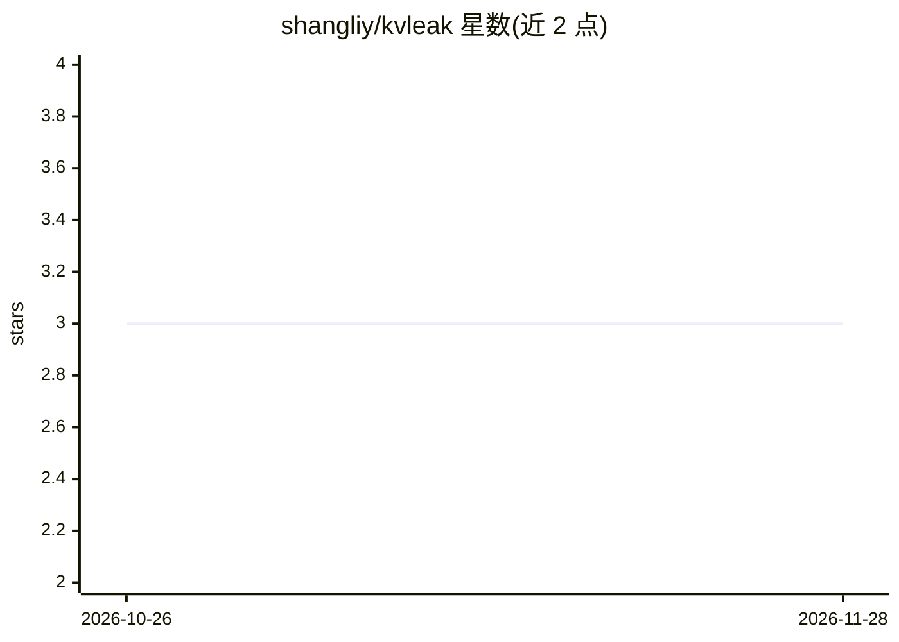

# shangliy/kvleak

⭐ 3 · Python · MIT · 推送 2026-10-23 · [GitHub](https://github.com/shangliy/kvleak) · [官网](https://pypi.org/project/kvleak/) · 个人维护 · 中文 README

**为 Claude Code 用户定位 prompt cache token 浪费的 CLI 工具**

读取 Claude Code、Codex CLI、Gemini CLI、OpenCode 本地留存会话文件，审计 prompt cache 命中与 cache rebuild 花费，定位可避免的未命中部分并折算金额；提供 tune/hooks/refine/statusline 等命令写入 Claude Code 设置、安装 hooks、注入上下文规则并在状态栏显示缓存倒计时。无 API key、无配置、无网络调用、无依赖，本地运行。以 PyPI 包分发，另可安装为 Claude Code skill/plugin。

## 筛选速览

| 维度 | 判定 | 备注 |
|---|---|---|
| AI 角色 | `ai-ecosystem` | LLM/agent 周边工具 |
| 许可风险 | `permissive` | MIT |
| 部署形态 | `library` | 以包/库形式分发 |
| 模型依赖 | — | README 未给出锁定关系 |
| 硬件要求 | — | 无带数字的原话,不猜 |
| 安装摩擦 | `low` | 无编译、无系统依赖或容器化 |
| 成熟度 | — | 结构信号不足 |

## 能力要点

- audit 报告：命中率、泄露金额、泄露构成（如 TTL 过期的空闲间隔）
- tune 命令重放 30 天历史，按设置项取最优值写入 settings.json（可 --reset 撤销）
- hooks 将长 shell 输出截为 head+tail+路径，压缩内容存档可由 recall 检索
- whatif 以自身账单重放工具压缩器的收益上界

## 适用场景

- 排查 Claude Code 账单中 cache rebuild 造成的花费
- 按自身历史数据调优 compaction 窗口与缓存 TTL
- 在状态栏实时观察缓存剩余时间与重建成本

## 场景标签

`LLM 可观测性` · 领域:评测与运维

## 证据(README 行号)

> L24: No API key, no config, no network calls, no dependencies. It reads the session
> L133: |`kvleak pointer`, `--fail-over`, `--path`|Multi-agent hand-off pointers, a CI gate on leak share, any JSONL with 

## 星数曲线

2026-10-26 3 → 2026-11-28 3（+0）

---
*卡片 v1 · prompt 1.4 · 生成 2026-11-21 · 置信度 high · 依据 README sha `6bf843b97567` · [字段定义](../../DATASET.md)*
