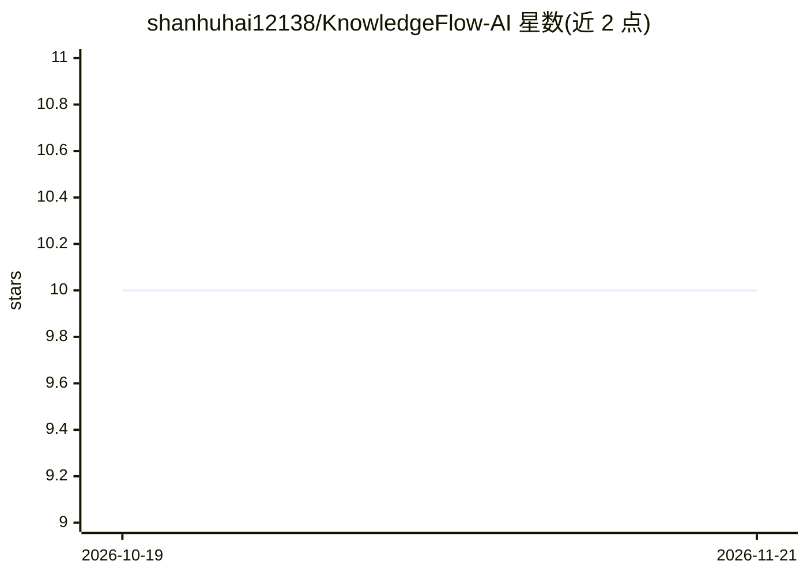

# shanhuhai12138/KnowledgeFlow-AI

⭐ 10 · Java · MIT · 推送 2026-09-18 · [GitHub](https://github.com/shanhuhai12138/KnowledgeFlow-AI) · 个人维护 · 中文 README

**全栈 RAG 知识库与 Agent 工作流平台，供团队搭建文档问答**

混合全栈知识管理平台：上传 PDF/DOCX/TXT/MD 文档后经 Redis Streams 异步管道解析分块并向量化入库，提问时通过 Dense + BM25 双路召回与 RRF 融合检索生成带来源引用的回答；另提供 LangGraph 六节点 Agent 工作流（含 human-in-the-loop 人工确认节点）与检索质量评测（Recall@5/MRR@5 可复现存档）。由 Spring Boot + Vue 3 + FastAPI 组成，Docker Compose 一键部署，README 诚实标注个人演示系统的能力边界。

## 筛选速览

| 维度 | 判定 | 备注 |
|---|---|---|
| AI 角色 | `ai-native` | 本体是模型或模型工具 |
| 许可风险 | `permissive` | MIT |
| 部署形态 | `self-host` | docker 或自建部署 |
| 模型依赖 | — | README 未给出锁定关系 |
| 硬件要求 | — | 无带数字的原话,不猜 |
| 安装摩擦 | `low` | 无编译、无系统依赖或容器化 |
| 成熟度 | — | 结构信号不足 |

## 能力要点

- Dense + BM25(jieba) 双路召回、RRF 融合，意图识别自动推荐检索模式
- LangGraph 多节点 Agent 工作流，含人工确认门控与 SSE 步骤级可观测
- 20+2 条标注集的检索质量评测，四指标可一键重跑
- Redis Streams 异步文档管道（ack/重试/死信/幂等）与多知识库租户隔离

## 适用场景

- 上传团队文档搭建带引用来源的内部知识库问答
- 运行多步骤文档分析工作流并在关键节点人工确认
- 复现和对比不同检索模式的召回质量指标

## 场景标签

`RAG` `文档问答` `模型评测` · 领域:评测与运维

## 证据(README 行号)

> L13: - **智能问答**：基于 RAG 的语义检索，支持多轮对话和来源引用
> L14: - **Agent 工作流**：LangGraph 多节点图（检索 → 摘要 → 分类 → 人工确认 → 报告，检索无结果走直接回答分支），步骤级可观测（SSE 事件流 + 每步耗时）
> L34: |AI 服务|Python FastAPI + LangGraph|

## 星数曲线

2026-10-19 10 → 2026-11-21 10（+0）

---
*卡片 v1 · prompt 1.4 · 生成 2026-11-19 · 置信度 high · 依据 README sha `96c29cf4351b` · [字段定义](../../DATASET.md)*
