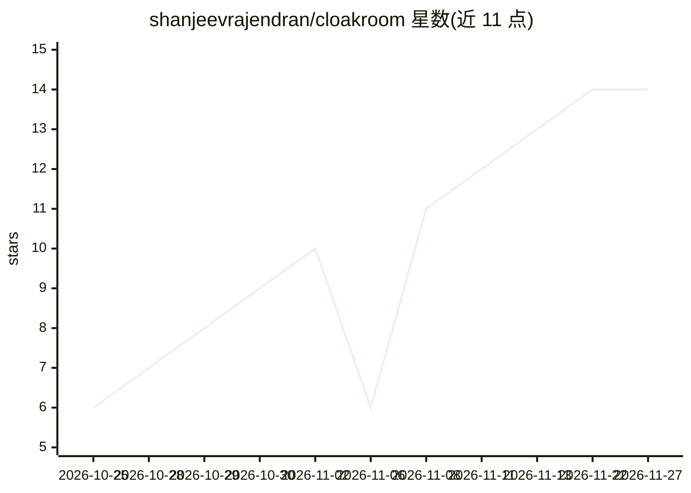

# shanjeevrajendran/cloakroom

⭐ 14 · Python · Apache-2.0 · 推送 2026-11-19 · [GitHub](https://github.com/shanjeevrajendran/cloakroom) · [官网](https://cloakroom.sh/) · 个人维护

**AI 编码代理读取文件前在本地掩码密钥与个人隐私数据**

以钩子形式挂在 Claude Code、Codex、Gemini CLI、Cursor 等编码代理的工具调用前后：进入方向用规则加本地小型检测模型识别密钥与 PII，替换为会话内一致的占位符；真实值存于本机加密保险库，密钥交由操作系统密钥链保管。代理写出文件或执行命令前，占位符被换回真实值。除一次性模型下载外数据不出本机，无法校验的内容会被扣留而非放行。1.4 版新增对历史聊天中已泄露个人数据的扫描。作者自称非沙箱，不覆盖 Cursor Tab 补全与厂商服务端网页搜索。

## 筛选速览

| 维度 | 判定 | 备注 |
|---|---|---|
| AI 角色 | `ai-enhanced` | 去掉 AI 部分产品仍成立 |
| 许可风险 | `permissive` | Apache-2.0 |
| 部署形态 | `library` | 以包/库形式分发 |
| 模型依赖 | — | README 未给出锁定关系 |
| 硬件要求 | — | 无带数字的原话,不猜 |
| 安装摩擦 | `low` | 无编译、无系统依赖或容器化 |
| 成熟度 | — | 结构信号不足 |

## 能力要点

- 进入/离开双向钩子：占位符替换与真实值回填
- 加密保险库存真实值，密钥在 OS keystore，代理无法读取
- 本地 OCR 处理图片与 PDF，规则模式可关闭模型下载
- exposure 命令列出代理看过的密钥以提示轮换

## 适用场景

- 使用 AI 编码代理时防止 .env 中的密钥进入上下文
- 阻止代理把个人数据写入提交或发往外部
- 排查旧聊天记录中已暴露的密钥并轮换

## 场景标签

`网络安全` · 领域:学习与行业

## 证据(README 行号)

> L19: **Cloakroom masks API keys, passwords and personal data on your machine before your AI coding agent sees them, and
> L58: Cloakroom runs as hooks: checks the agent calls before and after each tool call. On the way in, pattern rules plus 
> L116: - **Not a sandbox.** It stops accidental leaks and contains prompt injection; it doesn't prevent it. An agent runs

## 星数曲线

2026-10-25 6 → 2026-11-27 14（+8）

---
*卡片 v1 · prompt 1.4 · 生成 2026-11-18 · 置信度 low · 依据 README sha `2b10a65bde9a` · [字段定义](../../DATASET.md)*
