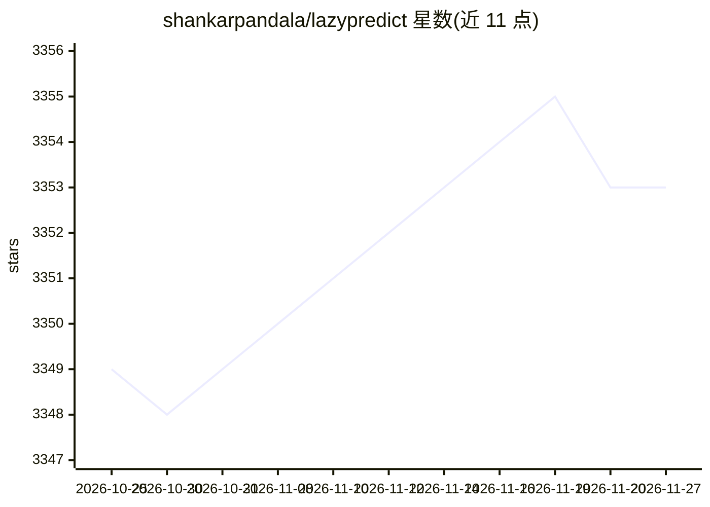

# shankarpandala/lazypredict

⭐ 3,353 · Python · MIT · 推送 2026-10-31 · [GitHub](https://github.com/shankarpandala/lazypredict) · 个人维护

**少代码批量基准测试分类/回归/时序模型的 Python AutoML 库**

以一行调用批量训练 40+ 机器学习模型并输出对比指标表，覆盖分类（LazyClassifier）、回归（LazyRegressor）与时间序列预测（LazyForecaster，20+ 模型含统计/ML/深度学习/TimesFM）。提供分类特征编码策略、季节周期自动检测、超时与交叉验证配置、MLflow 实验追踪集成，以及可选 GPU 加速（XGBoost/LightGBM/CatBoost/cuML）。经 pip/conda 安装，boost、encoders、timeseries 等为可选依赖组。

## 筛选速览

| 维度 | 判定 | 备注 |
|---|---|---|
| AI 角色 | `ai-native` | 本体是模型或模型工具 |
| 许可风险 | `permissive` | MIT |
| 部署形态 | `library` | 以包/库形式分发 |
| 模型依赖 | — | README 未给出锁定关系 |
| 硬件要求 | — | 无带数字的原话,不猜 |
| 安装摩擦 | `medium` | 含编译或系统依赖之一 |
| 成熟度 | — | 结构信号不足 |

## 能力要点

- 一次调用批量基准测试 40+ 分类与回归模型，输出指标对比表
- 20+ 时序预测模型，含统计模型、深度学习与预训练 TimesFM
- 可选 GPU 加速后端（XGBoost/LightGBM/CatBoost/cuML）
- 内置 MLflow 实验追踪集成与多种类别编码策略

## 适用场景

- 快速对比多种模型在数据集上的基线表现
- 时间序列预测任务的模型批量评测
- 在 notebook 中少代码探索分类/回归方案

## 场景标签

`模型评测` · 领域:评测与运维

## 证据(README 行号)

> L10: Lazy Predict helps build a lot of basic models without much code and helps understand which models work better with
> L16: - Over 40 built-in machine learning models
> L17: - Automatic model selection for classification, regression, and **time series forecasting**

## 星数曲线

2026-10-25 3,349 → 2026-11-27 3,353（+4）

---
*卡片 v1 · prompt 1.4 · 生成 2026-11-23 · 置信度 high · 依据 README sha `3045400cda10` · [字段定义](../../DATASET.md)*
