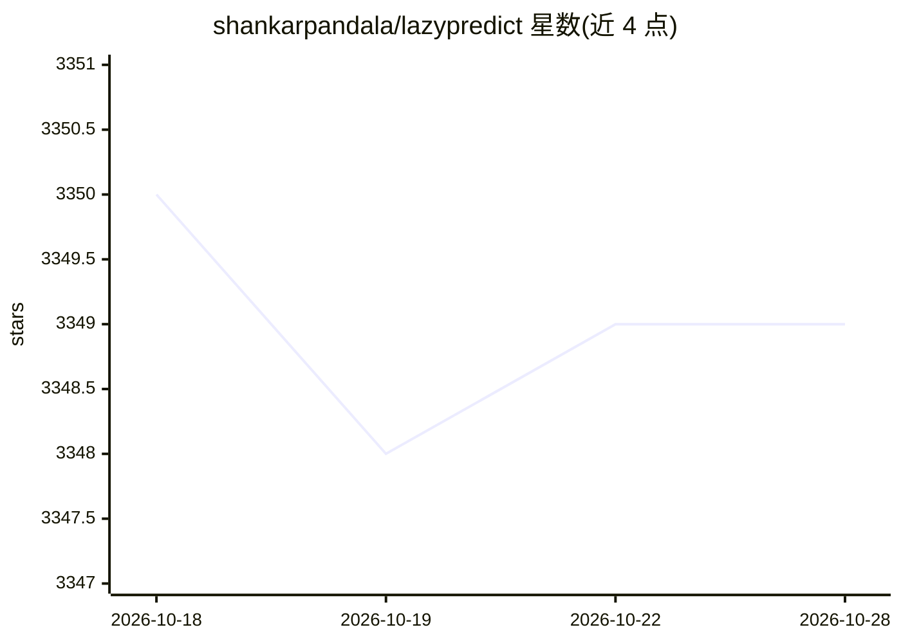

# shankarpandala/lazypredict

⭐ 3,349 · Python · MIT · 推送 2026-09-13 · [GitHub](https://github.com/shankarpandala/lazypredict) · 个人维护

**Python AutoML 基准工具：批量训练并对比分类/回归/时序模型**

LazyPredict 以少量代码同时训练 40+ 内置机器学习模型并输出指标对比表，覆盖分类、回归与时序预测（含统计、ML、深度学习及 TimesFM 基础模型共 20+ 个预测模型），支持自动季节周期检测、多种类别编码、交叉验证与超时控制，内置 MLflow 实验跟踪。GPU 加速面向 XGBoost/LightGBM/CatBoost/cuML/LSTM/GRU/TimesFM，无 CUDA 时自动回退 CPU。以 pip/conda 安装的 Python 库形式提供，部分模型需安装可选依赖扩展。

## 筛选速览

| 维度 | 判定 | 备注 |
|---|---|---|
| AI 角色 | `ai-native` | 本体是模型或模型工具 |
| 许可风险 | `permissive` | MIT |
| 部署形态 | `library` | 以包/库形式分发 |
| 模型依赖 | — | README 未给出锁定关系 |
| 硬件要求 | — | 无带数字的原话,不猜 |
| 安装摩擦 | `medium` | 含编译或系统依赖之一 |
| 成熟度 | — | 结构信号不足 |

## 能力要点

- 一次调用批量训练 40+ 模型并生成指标排行表
- 时序预测覆盖统计/ML/LSTM/GRU/TimesFM 等 20+ 模型
- GPU 加速（XGBoost、LightGBM、CatBoost、cuML、PyTorch）自动回退 CPU
- 内置 MLflow 实验跟踪与自定义评估指标

## 适用场景

- 建模初期快速筛出表现较好的候选模型
- 对时序数据一次性基准测试多种预测方法
- 对比 GPU 与 CPU 下各模型的训练耗时与指标

## 场景标签

`模型评测` · 领域:评测与运维

## 证据(README 行号)

> L10: Lazy Predict helps build a lot of basic models without much code and helps understand which models work better with
> L16: - Over 40 built-in machine learning models
> L17: - Automatic model selection for classification, regression, and **time series forecasting**

## 星数曲线

2026-10-18 3,350 → 2026-10-28 3,349（-1）

---
*卡片 v1 · prompt 1.4 · 生成 2026-10-20 · 置信度 high · 依据 README sha `c50c2bd143dd` · [字段定义](../../DATASET.md)*
