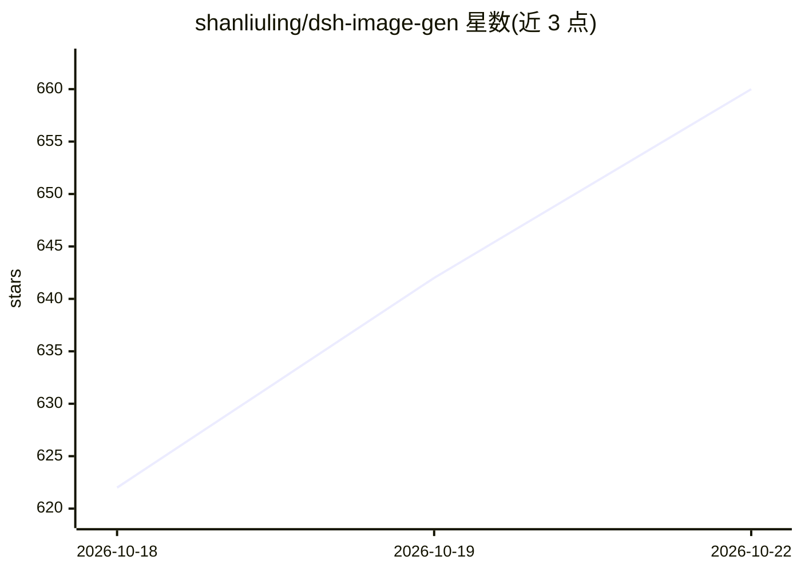

# shanliuling/dsh-image-gen

⭐ 665 · TypeScript · Apache-2.0 · 推送 2026-10-20 · [GitHub](https://github.com/shanliuling/dsh-image-gen) · [官网](https://github.com/shanliuling/dsh-image-gen#readme) · 个人维护 · 中文 README

**DeepSeek Harness 的 AI 图像创作插件：对话生图、画布与多模型对比**

面向 DeepSeek Harness（DSH）的图像生成插件：在对话中完成文生图、图生图与连续编辑，提供无限画布草稿创作、Studio 批量生成、多模型横向对比、500+ Prompt 灵感库、图库与收藏管理。接入 Gemini、OpenAI 及兼容渠道、Seedream、DashScope、Grok Imagine、GLM-Image 与本地 ComfyUI 等多类 Provider，支持 BYOK 与 ChatGPT/Grok/Google 订阅账号免 Key 登录。限制：Studio 与多模型对比仅支持云端 Provider，ComfyUI 未接入；需 DSH 稳定版与 Node.js 22.19+/24+。

## 筛选速览

| 维度 | 判定 | 备注 |
|---|---|---|
| AI 角色 | `ai-native` | 本体是模型或模型工具 |
| 许可风险 | `permissive` | Apache-2.0 |
| 部署形态 | `None` |  |
| 模型依赖 | locked-api |  |
| 硬件要求 | — | 无带数字的原话,不猜 |
| 安装摩擦 | `low` | 无编译、无系统依赖或容器化 |
| 成熟度 | — | 结构信号不足 |

## 能力要点

- 对话文生图/图生图/连续编辑与版本切换
- AI 创作画布：草稿绘制+参考图组合生成成图
- 同一 Prompt 并发调用多模型横向对比
- 本地 ComfyUI 多命名工作流接入（限对话生图/单图编辑）

## 适用场景

- 在 DSH 对话中直接生成与迭代修改图片
- 用已有 ChatGPT/Grok/Google 订阅免 Key 生图
- 在画布上组合草稿与参考图做视觉创作
- 用本地 ComfyUI 工作流私有化生图

## 场景标签

 · 领域:AI 图像生成/开发工具插件

## 证据(README 行号)

> L36: **为 DeepSeek Harness 带来完整的 AI 图像创作工作流。**
> L44: 支持：Gemini · OpenAI / Compatible · Seedream · DashScope · Grok Imagine · GLM-Image · 本地 ComfyUI

## 星数曲线

2026-10-18 622 → 2026-10-22 660（+38）

---
*卡片 v1 · prompt 1.4 · 生成 2026-10-21 · 置信度 high · 依据 README sha `cc661578e11e` · [字段定义](../../DATASET.md)*
