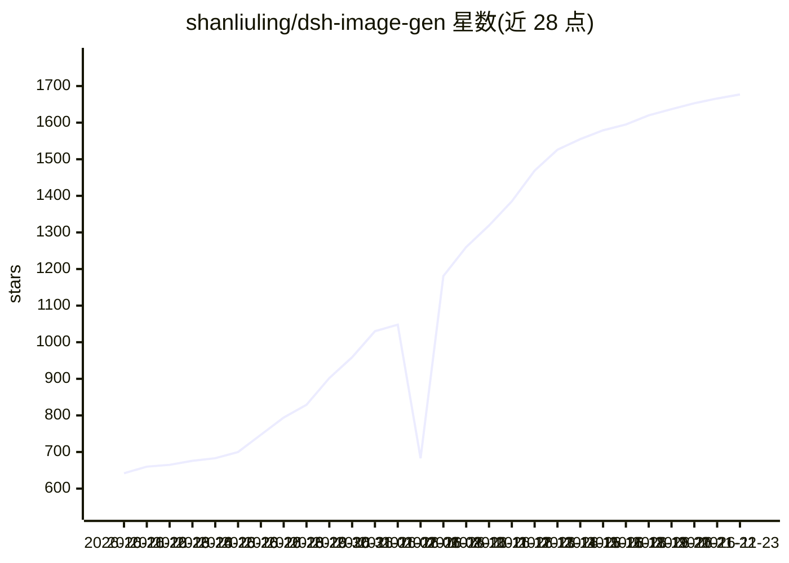

# shanliuling/dsh-image-gen

⭐ 1,677 · TypeScript · Apache-2.0 · 推送 2026-11-22 · [GitHub](https://github.com/shanliuling/dsh-image-gen) · [官网](https://github.com/shanliuling/dsh-image-gen#readme) · 个人维护 · 中文 README

**DeepSeek Harness 对话生图插件：批量生成、编辑与多模型对比**

作为 DeepSeek Harness 的原生插件，让 Agent 在对话中直接产出图像：一条消息批量规划并逐张生成（单次最多 10 张、单张失败不中断）、读取画布选区做草图转成图与局部圈选编辑、维护角色一致性、生成 GIF 与 SVG。内置 500+ Prompt 灵感库、Studio 工作台、多模型横向对比与图库管理，支持本地 ComfyUI 多工作流。需 Node.js 22.19+ 环境与 DeepSeek Harness 稳定版，通过 pnpm 插件命令安装，按 Provider 填 API Key 或用订阅账号免 Key 登录。

## 筛选速览

| 维度 | 判定 | 备注 |
|---|---|---|
| AI 角色 | `ai-native` | 本体是模型或模型工具 |
| 许可风险 | `permissive` | Apache-2.0 |
| 部署形态 | `None` |  |
| 模型依赖 | locked-api |  |
| 硬件要求 | — | 无带数字的原话,不猜 |
| 安装摩擦 | `low` | 无编译、无系统依赖或容器化 |
| 成熟度 | — | 结构信号不足 |

## 能力要点

- 对话批量生图：单次最多 10 张，逐张生成、失败自动列出原因
- AI 画布：读取草图与圈选区域，做草图转成图与局部编辑
- 内置 500+ Prompt 灵感库与 Studio 工作台、多模型对比
- 支持本地 ComfyUI 多命名工作流与订阅账号免 Key 登录

## 适用场景

- 给文章、笔记批量配一组风格统一的插图
- 在画布上圈出图片局部并指定修改内容
- 同一 Prompt 并发调用多个模型对比出图效果
- 用本地 ComfyUI 工作流在对话中私有化绘图

## 场景标签

`图像生成` · 领域:内容生成

## 证据(README 行号)

> L35: `dsh-image-gen` 是 DeepSeek Harness 的原生图像创作插件。它不是在对话框里塞一个生图按钮，而是让 **Agent 本身学会画图**：它能一次规划并生成一整组图，能看懂你在画布上的涂鸦和圈选，能自己去
> L76: 环境要求：DeepSeek Harness 稳定版本，Node.js `^22.19.0` 或 `>= 24.0.0`。
> L258: ## Provider 支持情况

## 星数曲线

2026-10-21 642 → 2026-11-23 1,677（+1,035）

---
*卡片 v1 · prompt 1.4 · 生成 2026-11-23 · 置信度 high · 依据 README sha `d12453ebf366` · [字段定义](../../DATASET.md)*
