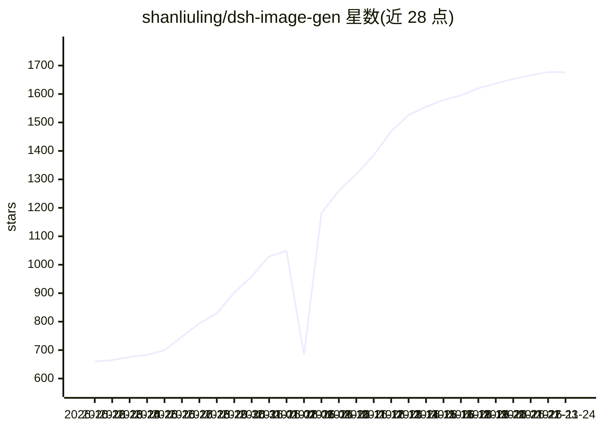

# shanliuling/dsh-image-gen

⭐ 1,709 · TypeScript · Apache-2.0 · 推送 2026-11-24 · [GitHub](https://github.com/shanliuling/dsh-image-gen) · [官网](https://github.com/shanliuling/dsh-image-gen#readme) · 个人维护 · 中文 README

**DeepSeek Harness 的对话生图插件：一句话批量出图**

以 DeepSeek Harness 插件形式安装（pnpm dsh plugin），让对话中的 Agent 具备文生图、图生图、局部编辑、批量出图（单次最多 10 张、单张失败不影响其余）能力。内置 AI 画布可读取草图与圈选区域做定向修改，500+ Prompt 灵感库由 Agent 检索套用，另有 Studio 工作台调参、多模型并发对比、图库管理与 GIF 动图生成。支持订阅账号登录免 API Key 生图；Studio 与多模型对比仅限云端 Provider，ComfyUI 未接入这两项。

## 筛选速览

| 维度 | 判定 | 备注 |
|---|---|---|
| AI 角色 | `ai-native` | 本体是模型或模型工具 |
| 许可风险 | `permissive` | Apache-2.0 |
| 部署形态 | `None` |  |
| 模型依赖 | locked-api |  |
| 硬件要求 | — | 无带数字的原话,不猜 |
| 安装摩擦 | `low` | 无编译、无系统依赖或容器化 |
| 成熟度 | — | 结构信号不足 |

## 能力要点

- 对话批量生图：单次最多 10 张，失败单张自动重跑不中断整组
- AI 画布读取草图与圈选区域，实现圈哪改哪的局部编辑
- 内置 500+ Prompt 灵感库，Agent 自动检索并套用模板
- 本地 ComfyUI 多命名工作流接入，占位符传 prompt/seed/尺寸

## 适用场景

- 给文章或小红书笔记一次性配一组风格统一的插图
- 在画布上圈出图片局部让 AI 只改那一处
- 同一 Prompt 并发调多个模型对比出图效果
- 用本地 ComfyUI 私有化绘图并融入对话流程

## 场景标签

`图像生成` `聊天机器人` · 领域:对话与助手

## 证据(README 行号)

> L35: `dsh-image-gen` 是 DeepSeek Harness 的原生图像创作插件。它不是在对话框里塞一个生图按钮，而是让 **Agent 本身学会画图**：它能一次规划并生成一整组图，能看懂你在画布上的涂鸦和圈选，能自己去
> L39: 支持：Gemini · OpenAI / Compatible · Seedream · DashScope · Grok Imagine · GLM-Image · 本地 ComfyUI

## 星数曲线

2026-10-22 660 → 2026-11-24 1,677（+1,017）

---
*卡片 v1 · prompt 1.4 · 生成 2026-11-24 · 置信度 high · 依据 README sha `6d55c3c0ae79` · [字段定义](../../DATASET.md)*
