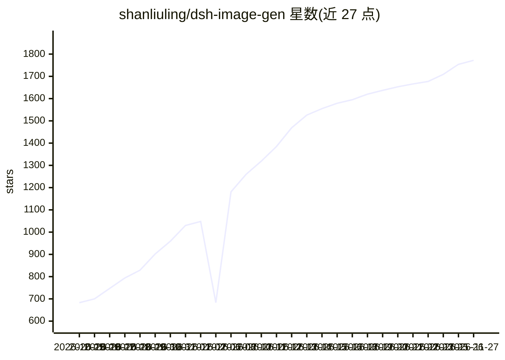

# shanliuling/dsh-image-gen

⭐ 1,772 · TypeScript · Apache-2.0 · 推送 2026-11-24 · [GitHub](https://github.com/shanliuling/dsh-image-gen) · [官网](https://github.com/shanliuling/dsh-image-gen#readme) · 个人维护 · 中文 README

**DeepSeek Harness 对话内批量生图/改图的插件**

以插件形式运行于 DeepSeek Harness 的图像创作工具：在对话中由 Agent 规划 Prompt 并批量生成图片（单次最多 10 张）、读取画布草图与圈选做局部编辑、按角色一致性做图生图、生成 GIF 与 SVG 输出。内置 500+ Prompt 灵感库与本地缓存，提供 Studio 参数工作台、多模型对比与图库管理。依赖宿主 DeepSeek Harness 与 Node.js ^22.19.0/>=24.0.0；通过 pnpm 安装插件，Provider 需自备 API Key 或订阅登录；tldraw 画布在 HTTPS 部署需另行填写 License Key。

## 筛选速览

| 维度 | 判定 | 备注 |
|---|---|---|
| AI 角色 | `ai-native` | 本体是模型或模型工具 |
| 许可风险 | `permissive` | Apache-2.0 |
| 部署形态 | `None` |  |
| 模型依赖 | locked-api |  |
| 硬件要求 | — | 无带数字的原话,不猜 |
| 安装摩擦 | `low` | 无编译、无系统依赖或容器化 |
| 成熟度 | — | 结构信号不足 |

## 能力要点

- 对话批量生图：Agent 规划一组 Prompt 逐张生成，单次最多 10 张
- AI 画布读取草图与圈选，支持局部编辑与草图转成图
- 内置 500+ Prompt 灵感库，Agent 检索后自动套用模板
- 支持本地 ComfyUI 多命名工作流与多模型并发对比

## 适用场景

- 给文章或小红书笔记一键配一组风格统一的插图
- 在画布上圈出图片局部并要求替换
- 同一 Prompt 用多个模型出图对比挑选
- 用本地 ComfyUI 工作流在对话里生图

## 场景标签

`图像生成` · 领域:内容生成

## 证据(README 行号)

> L35: `dsh-image-gen` 是 DeepSeek Harness 的原生图像创作插件。它不是在对话框里塞一个生图按钮，而是让 **Agent 本身学会画图**：它能一次规划并生成一整组图，能看懂你在画布上的涂鸦和圈选，能自己去
> L39: 支持：Gemini · OpenAI / Compatible · Seedream · DashScope · Grok Imagine · GLM-Image · 本地 ComfyUI
> L76: 环境要求：DeepSeek Harness 稳定版本，Node.js `^22.19.0` 或 `>= 24.0.0`。

## 星数曲线

2026-10-25 683 → 2026-11-27 1,772（+1,089）

---
*卡片 v1 · prompt 1.4 · 生成 2026-11-26 · 置信度 high · 依据 README sha `23aca5c74c88` · [字段定义](../../DATASET.md)*
