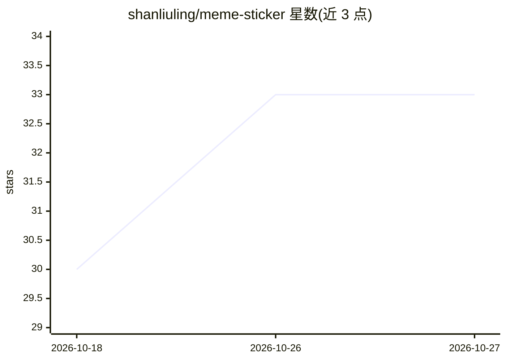

# shanliuling/meme-sticker

⭐ 33 · Python · MIT · 推送 2026-08-30 · [GitHub](https://github.com/shanliuling/meme-sticker) · [官网](https://github.com/shanliuling/meme-sticker) · 个人维护 · 中文 README

**Agent 技能：一张图生成整套透明 PNG 聊天表情贴纸**

面向兼容 Skills 的 AI Agent 的开源贴纸生成技能（MIT）：用户上传一张自拍/宠物/角色等图片，通过一次图像生成调用产出整张贴纸表，随后自动切分、去背景并导出为带透明通道的单张 PNG 贴纸，附带预览与 ZIP 打包。安装方式为 npx skills add，宿主需支持 Skills 及图像生成/编辑能力，并具备 Python 3.10+（首跑可能安装 NumPy 和 Pillow）。角色一致性与复杂背景处理效果取决于宿主图像模型。

## 筛选速览

| 维度 | 判定 | 备注 |
|---|---|---|
| AI 角色 | `ai-native` | 本体是模型或模型工具 |
| 许可风险 | `permissive` | MIT |
| 部署形态 | `library` | 以包/库形式分发 |
| 模型依赖 | — | README 未给出锁定关系 |
| 硬件要求 | — | 无带数字的原话,不猜 |
| 安装摩擦 | `low` | 无编译、无系统依赖或容器化 |
| 成熟度 | — | 结构信号不足 |

## 能力要点

- 一张图一次生成调用产出整套贴纸
- 自动切分、去背景、导出透明 PNG 与 ZIP 打包
- 不绑定单一模型或平台，可跨兼容 Agent 复用
- 配文跟随用户语言

## 适用场景

- 把自拍、宠物或角色照片做成成套聊天表情贴纸
- 为工作群或社交场景定制特定主题的表情包
- 给支持 Skills 的 AI Agent 增加贴纸生成能力

## 场景标签

`图像生成` `图像视频处理` · 领域:内容生成

## 证据(README 行号)

> L11: Generate the whole pack in one image call, then auto-split, remove backgrounds, and export transparent PNGs.
> L26: - **Agent-native** — install the Skill and reuse the same workflow across compatible Agents.

## 星数曲线

2026-10-18 30 → 2026-10-27 33（+3）

---
*卡片 v1 · prompt 1.4 · 生成 2026-10-25 · 置信度 high · 依据 README sha `46bbd64ccc84` · [字段定义](../../DATASET.md)*
