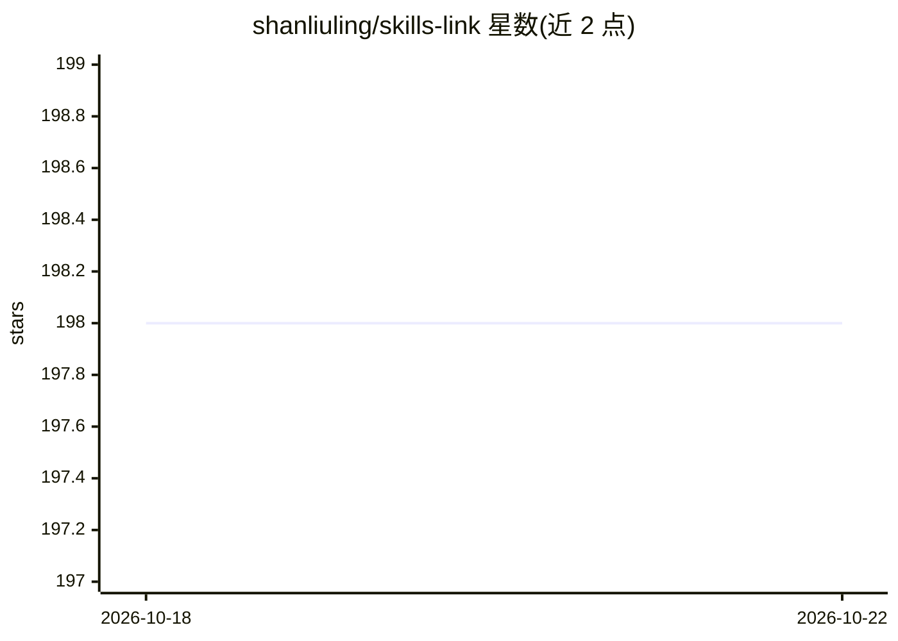

# shanliuling/skills-link

⭐ 198 · TypeScript · MIT · 推送 2026-05-14 · [GitHub](https://github.com/shanliuling/skills-link) · 个人维护 · 中文 README

**跨 41+ AI 编码代理统一同步本地 skills 的 CLI 工具**

Node.js 命令行工具，将各 AI 编码代理（Claude Code、Cursor、Windsurf 等 41+）的 skills 目录以符号链接指向统一主目录，一处添加或修改技能即对所有应用生效。首次运行自动检测应用、导入技能并创建链接；另提供 rules-link 同步规则、从 GitHub 仓库安装技能、推送/拉取实现跨设备同步。Windows 用 Junction 链接无需管理员权限，macOS/Linux 用原生符号链接；支持中英文，要求 Node.js 18+。

## 筛选速览

| 维度 | 判定 | 备注 |
|---|---|---|
| AI 角色 | `ai-ecosystem` | LLM/agent 周边工具 |
| 许可风险 | `permissive` | MIT |
| 部署形态 | `library` | 以包/库形式分发 |
| 模型依赖 | — | README 未给出锁定关系 |
| 硬件要求 | — | 无带数字的原话,不猜 |
| 安装摩擦 | `low` | 无编译、无系统依赖或容器化 |
| 成熟度 | — | 结构信号不足 |

## 能力要点

- 41+ AI 编码代理开箱支持，另有 universal 兜底并可一行代码新增代理
- skills 目录符号链接指向单一主目录，一次修改全应用生效
- skills-link add/sync 命令支持从 GitHub 安装技能与跨设备同步
- Windows Junction 链接无需管理员权限

## 适用场景

- 在多个 AI 编码代理间共用同一套本地技能
- 从 GitHub 仓库一键安装技能到所有代理
- 多台机器间同步 skills 并检查链接健康状态

## 场景标签

 · 领域:开发者工具/AI 代理配置管理

## 证据(README 行号)

> L7: Sync your local `skills` across 41+ AI coding agents with a single command.
> L26: Every app's `~/.xxx/skills` becomes a symlink pointing to one master directory. Add or edit a skill once — every ap

## 星数曲线

2026-10-18 198 → 2026-10-22 198（+0）

---
*卡片 v1 · prompt 1.4 · 生成 2026-10-22 · 置信度 high · 依据 README sha `351640d635bb` · [字段定义](../../DATASET.md)*
