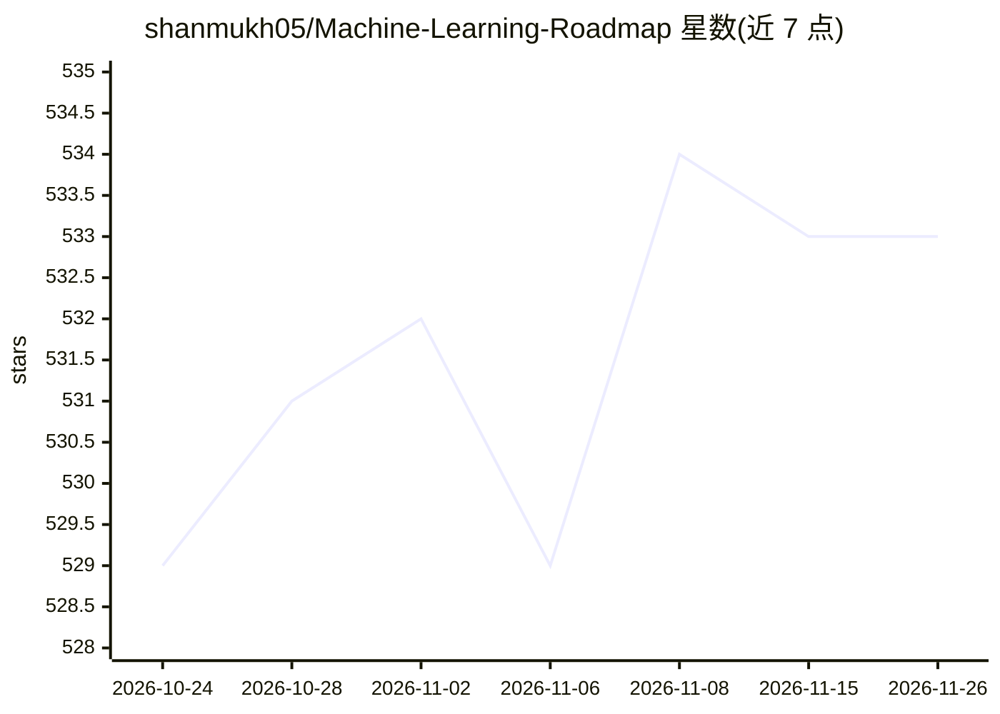

# shanmukh05/Machine-Learning-Roadmap

⭐ 533 · MIT · 推送 2026-10-21 · [GitHub](https://github.com/shanmukh05/Machine-Learning-Roadmap) · [官网](https://shanmukh05.github.io/Machine-Learning-Roadmap/) · 个人维护

**机器学习入门者的课程/书籍/工具学习路线图**

由一位在 KLA Corporation 任职的 AI 工程师维护的学习资源策展清单，按先修基础（数学、Python、数据结构）、机器学习、深度学习、框架与库、竞赛与研究入门等路径组织条目，每类下列出具体课程、书籍、官方文档与教程链接，并附带 YouTube 频道、博客、数据集、大学课程、Newsletter 与可视化工具等扩展资源。内容为纯资源索引，不含可运行的代码或安装流程，作者声明欢迎反馈与建议。

## 筛选速览

| 维度 | 判定 | 备注 |
|---|---|---|
| AI 角色 | `ai-knowledge` | 知识聚合/清单类 |
| 许可风险 | `permissive` | MIT |
| 部署形态 | `None` |  |
| 模型依赖 | — | README 未给出锁定关系 |
| 硬件要求 | — | 无带数字的原话,不猜 |
| 安装摩擦 | `low` | 无编译、无系统依赖或容器化 |
| 成熟度 | — | 结构信号不足 |

## 能力要点

- 按先修要求到进阶路径分层的资源组织结构
- 覆盖课程、书籍、官方文档、竞赛、论文与数据集等资源类型
- 附 PyTorch/TensorFlow/scikit-learn 等库的定位说明与官方教程指引

## 适用场景

- 从零规划机器学习的学习顺序
- 为 CV/NLP/表格数据方向挑选课程与书籍
- 查找大学公开课、数据集与竞赛平台入口

## 场景标签

`教程课程` `精选清单` · 领域:学习与行业

## 证据(README 行号)

> L2:  A curated collection of resources to start and advance your career in Machine Learning.
> L15: ## Introduction
> L67: ## Machine Learning

## 星数曲线

2026-10-24 529 → 2026-11-26 533（+4）

---
*卡片 v1 · prompt 1.4 · 生成 2026-11-25 · 置信度 high · 依据 README sha `aa63bc4715e1` · [字段定义](../../DATASET.md)*
