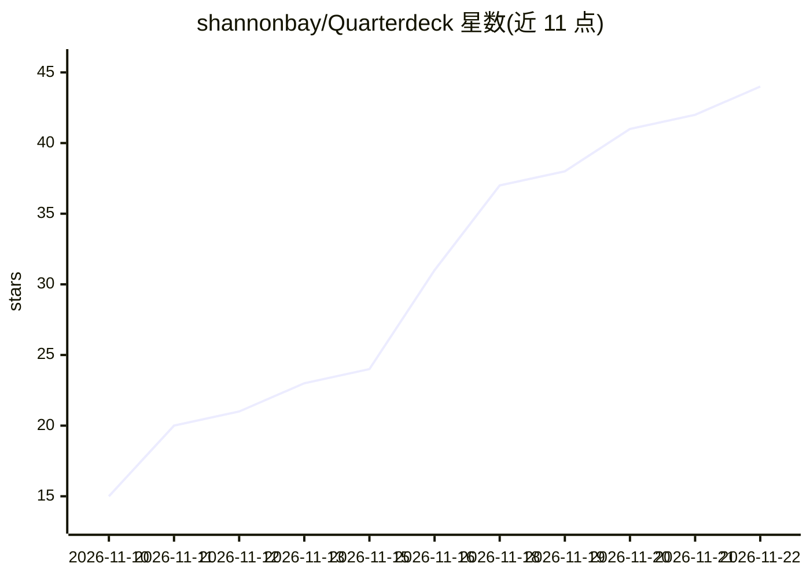

# shannonbay/Quarterdeck

⭐ 44 · TypeScript · Apache-2.0 · 推送 2026-11-21 · [GitHub](https://github.com/shannonbay/Quarterdeck) · 个人维护

**把 Claude Code 变成后台常驻个人助理的插件：目标式定时代理**

Quarterdeck 是一个 Claude Code 插件集（含一个 MCP server、quarterdeck-goals 与 quarterdeck-guard 两个插件及可选 web 应用），让用户以“目标”形式交给 Claude 持续照看的后台任务：每个目标按计划或 watch 触发独立子代理运行，动作先提案、经 Goals 面板或手机批准后执行，拒绝反馈会成为后续运行的记忆。按动作类别设 off/propose/auto 自治级别，工作项按外部 ID 去重，数据存于本地 SQLite。限制：需本机开机登录且 Claude Code 会话在场；作者自述早期阶段、单人开发于 Windows。以 npm 安装，面向个人用户。

## 筛选速览

| 维度 | 判定 | 备注 |
|---|---|---|
| AI 角色 | `ai-ecosystem` | LLM/agent 周边工具 |
| 许可风险 | `permissive` | Apache-2.0 |
| 部署形态 | `library` | 以包/库形式分发 |
| 模型依赖 | locked-api |  |
| 硬件要求 | — | 无带数字的原话,不猜 |
| 安装摩擦 | `low` | 无编译、无系统依赖或容器化 |
| 成熟度 | `idea` | |

## 能力要点

- 目标以调度/watch/webhook/健康检查触发后台子代理运行
- 人类在环：动作提案需批准，拒绝反馈转化为记忆
- 按动作类别的三级自治（off/propose/auto），连续批准 10 次可建议升级
- 架构为 MCP server + 两个 Claude Code 插件，数据存本地 SQLite

## 适用场景

- 让 Claude 定期清理收件箱、退订邮件、整理 Downloads
- 自动 triage、refine 并修复 GitHub 新 issue 到开出 PR，关键动作人工批准
- 每周扫描职位、生成每日新闻摘要等周期性个人事务

## 场景标签

`AI 助手` · 领域:对话与助手

## 证据(README 行号)

> L7: It's a Claude Code plugin that turns Claude into a personal assistant: it keeps looking after the things you hand it
> L69: It's an **MCP server** (the tools agents use) and two **Claude Code plugins**: `quarterdeck-goals` runs goals and s
> L61: - **From OpenClaw:** OpenClaw is a self-hosted, always-on assistant you message from WhatsApp, Telegram and other c

## 星数曲线

2026-11-10 15 → 2026-11-22 44（+29）

---
*卡片 v1 · prompt 1.4 · 生成 2026-11-18 · 置信度 high · 依据 README sha `035a2887acff` · [字段定义](../../DATASET.md)*
