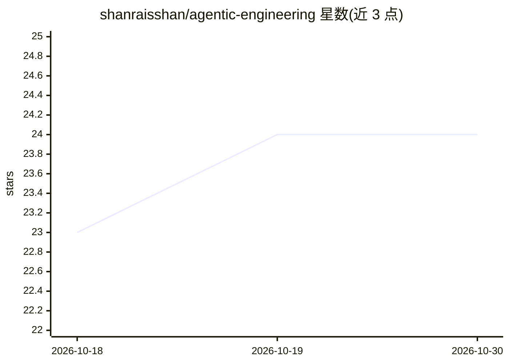

# shanraisshan/agentic-engineering

⭐ 24 · Python · 推送 2026-05-08 · [GitHub](https://github.com/shanraisshan/agentic-engineering) · [官网](https://linkedin.com/in/shanraisshan) · 个人维护

**AI 编码时代“代码是否重要”的辩论视频策展清单**

围绕“AI agent 时代是否还需要关注代码”这一问题的观点聚合仓库：以正反两方视频清单组织——正方（应读代码）收录 Matt Pocock、Dex Horthy、Armin Ronacher 等人的论述，反方（代码正在退化）收录 Andrej Karpathy、Boris Cherny 的访谈；另附 AI 术语表、主流 AI 编码工具（Claude Code/Codex CLI/Cursor/Gemini CLI）的上下文窗口与价格对比表，以及相关最佳实践仓库链接。内容为策展索引，不含可安装代码。

## 筛选速览

| 维度 | 判定 | 备注 |
|---|---|---|
| AI 角色 | `ai-knowledge` | 知识聚合/清单类 |
| 许可风险 | `none` | — |
| 部署形态 | `None` |  |
| 模型依赖 | — | README 未给出锁定关系 |
| 硬件要求 | — | 无带数字的原话,不猜 |
| 安装摩擦 | `low` | 无编译、无系统依赖或容器化 |
| 成熟度 | — | 结构信号不足 |

## 能力要点

- 正反两方观点的视频清单（作者+描述）
- 主流 AI 编码工具上下文窗口与输入/输出价格对比表
- AI 术语表与 Claude Code / Codex CLI / Gemini CLI 最佳实践仓库链接

## 适用场景

- 查找关于 AI 编码时代代码价值的不同观点
- 比较各 AI 编码工具的上下文窗口规模与定价
- 顺藤查找各 CLI 工具的最佳实践与 Hooks 仓库

## 场景标签

`精选清单` · 领域:学习与行业

## 证据(README 行号)

> L21: ## Does code matter?
> L25: |Video|Author|Description|
> L60: |Tool|Largest Context|Best Model|Input $/M|Output $/M|Source|

## 星数曲线

2026-10-18 23 → 2026-10-30 24（+1）

---
*卡片 v1 · prompt 1.4 · 生成 2026-10-27 · 置信度 high · 依据 README sha `8f878f7ec2e1` · [字段定义](../../DATASET.md)*
