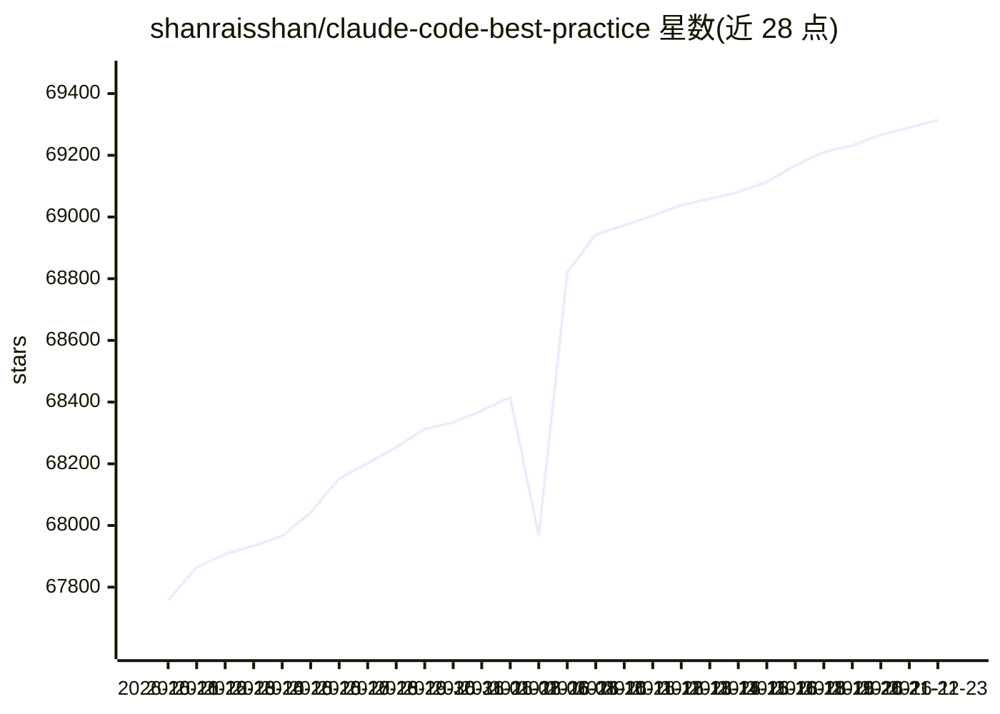

# shanraisshan/claude-code-best-practice

⭐ 69,315 · HTML · MIT · 推送 2026-11-22 · [GitHub](https://github.com/shanraisshan/claude-code-best-practice) · [官网](https://linkedin.com/in/shanraisshan) · 个人维护

**Claude Code 最佳实践与工作流策展清单，面向使用 Claude 编码的开发者**

策展型仓库：汇总 Claude Code 的概念索引（subagents、commands、skills、hooks、MCP、plugins、memory 等）及其在 .claude/ 下的配置位置，收录 Command→Agent→Skill 编排工作流实现、13 个社区开发工作流方法论（按星标排列）、跨模型协作机制（Plugin/MCP/Router）与 84 条提示与上下文管理技巧。内容以表格与外链为主，自身无安装依赖，使用方式是在 Claude Code 中运行 weather-orchestrator 等示例命令。

## 筛选速览

| 维度 | 判定 | 备注 |
|---|---|---|
| AI 角色 | `ai-knowledge` | 知识聚合/清单类 |
| 许可风险 | `permissive` | MIT |
| 部署形态 | `None` |  |
| 模型依赖 | — | README 未给出锁定关系 |
| 硬件要求 | — | 无带数字的原话,不猜 |
| 安装摩擦 | `low` | 无编译、无系统依赖或容器化 |
| 成熟度 | — | 结构信号不足 |

## 动量与使用信号

- 维护:`active` — 距上次 push 1.0 天,年发版 0,5 位贡献者
- 涨星:近 1 天 **+44**(自 20261016 起算)
- 平台:— · 协议:MCP / OLLAMA

## 能力要点

- 汇总 Subagents/Commands/Skills/Hooks/MCP 等特性的配置位置与实现链接
- 收录 13 个社区开发工作流方法论及 Command→Agent→Skill 编排示例
- 整理 Plugin/MCP/Router 三种跨模型协作机制与桥接工具清单
- 84 条提示、规划、上下文管理技巧（含来源标注）

## 适用场景

- 查找 Claude Code 某特性（skills、hooks、memory）的配置位置与官方文档
- 参考社区工作流方法论组织自己的 agentic 开发流程
- 了解让 Claude Code 配合 Codex、Gemini、本地模型等跨模型使用的机制

## 场景标签

`精选清单` · 领域:学习与行业

## 证据(README 行号)

> L1: # claude-code-best-practice
> L20: ## 🧠 CONCEPTS
> L178: ## 💡 TIPS AND TRICKS (84)

## 星数曲线

2026-10-21 67,758 → 2026-11-23 69,315（+1,557）

---
*卡片 v1 · prompt 1.4 · 生成 2026-11-23 · 置信度 high · 依据 README sha `0091ed0ba737` · [字段定义](../../DATASET.md)*
