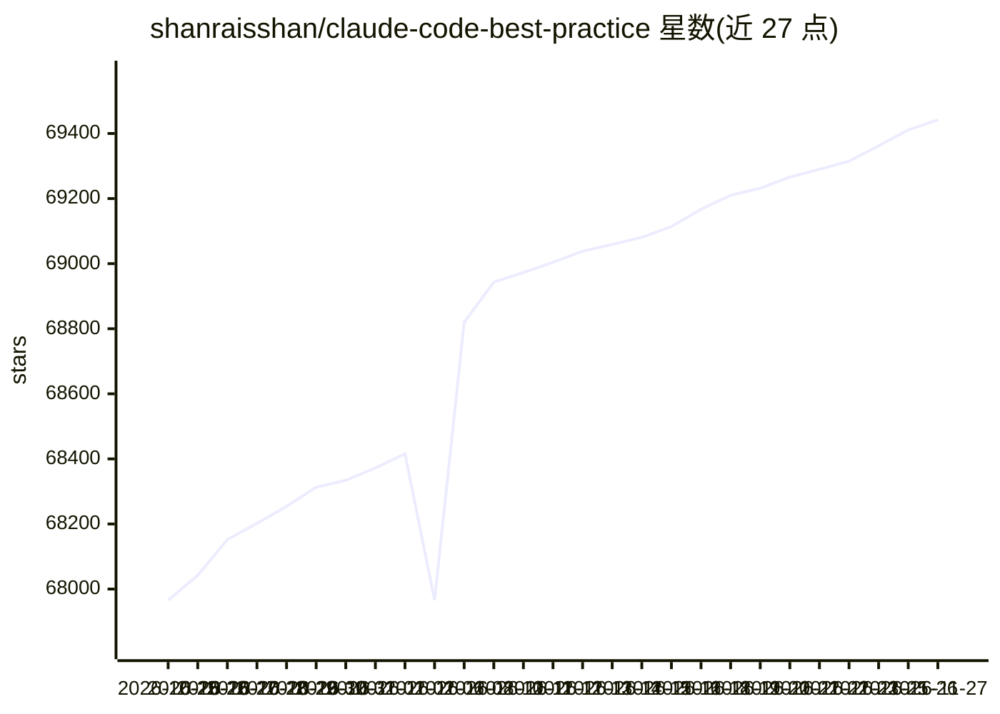

# shanraisshan/claude-code-best-practice

⭐ 69,442 · HTML · MIT · 推送 2026-11-26 · [GitHub](https://github.com/shanraisshan/claude-code-best-practice) · [官网](https://linkedin.com/in/shanraisshan) · 个人维护

**Claude Code 最佳实践与工作流知识库，面向开发者**

围绕 Anthropic 的 Claude Code 编纂的最佳实践资料库：整理 Subagents、Commands、Skills、Hooks、MCP Servers、Memory 等机制的官方文档与实现位置，汇总多种开发工作流方法论（Research→Plan→Execute→Review→Ship 模式）、跨模型协作方式（Plugin/MCP/Router）、技能与子代理仓库清单，以及 84 条来自 Boris Cherny、Anthropic 团队等来源的使用技巧。本仓库为文档/清单集合，不含可运行的模型代码；使用方式为阅读后在自己的项目中应用相关配置与命令。

## 筛选速览

| 维度 | 判定 | 备注 |
|---|---|---|
| AI 角色 | `ai-knowledge` | 知识聚合/清单类 |
| 许可风险 | `permissive` | MIT |
| 部署形态 | `None` |  |
| 模型依赖 | — | README 未给出锁定关系 |
| 硬件要求 | — | 无带数字的原话,不猜 |
| 安装摩擦 | `low` | 无编译、无系统依赖或容器化 |
| 成熟度 | — | 结构信号不足 |

## 动量与使用信号

- 维护:`active` — 距上次 push 1.0 天,年发版 0,5 位贡献者
- 涨星:近 1 天 **+44**(自 20261016 起算)
- 平台:— · 协议:MCP / OLLAMA

## 能力要点

- 整理 Claude Code 各机制（Subagents/Commands/Skills/Hooks/MCP/Memory）的最佳实践与文档位置
- 汇总十余种开发工作流方法论及其步骤链
- 收录跨模型协作三种机制：Plugin、MCP、Router
- 84 条来自 Claude Code 创建者与 Anthropic 团队的使用技巧

## 适用场景

- 为团队制定 Claude Code 使用规范时参考现成最佳实践
- 查找适合自己项目的 Claude Code 工作流方法论
- 了解如何在 Claude Code 中接入 Codex、Gemini、本地模型等其他模型

## 场景标签

`精选清单` · 领域:学习与行业

## 证据(README 行号)

> L1: # claude-code-best-practice
> L20: ## 🧠 CONCEPTS
> L39: |**Best Practices**||Prompt Engineering · Extend Claude Code|

## 星数曲线

2026-10-25 67,966 → 2026-11-27 69,442（+1,476）

---
*卡片 v1 · prompt 1.4 · 生成 2026-11-27 · 置信度 high · 依据 README sha `2963f807c043` · [字段定义](../../DATASET.md)*
