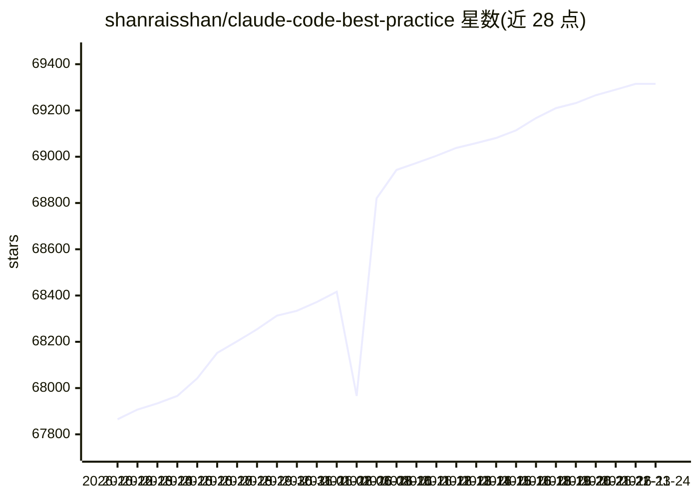

# shanraisshan/claude-code-best-practice

⭐ 69,362 · HTML · MIT · 推送 2026-11-23 · [GitHub](https://github.com/shanraisshan/claude-code-best-practice) · [官网](https://linkedin.com/in/shanraisshan) · 个人维护

**给 Claude Code 用户提供最佳实践与工作流整理的策展清单**

一个围绕 Claude Code 的知识与资源聚合仓库：整理 Claude Code 的概念表（Subagents/Commands/Skills/Hooks/MCP Servers/Plugins/Memory 等）、Command→Agent→Skill 编排工作流实现、多套开发工作流（Research→Plan→Execute→Review→Ship）条目、跨模型使用机制（Plugin/MCP/Router）及 84 条来自社区与 Anthropic 成员的提示技巧。本身不含可运行代码主体，使用方式是阅读条目并访问各来源仓库。

## 筛选速览

| 维度 | 判定 | 备注 |
|---|---|---|
| AI 角色 | `ai-knowledge` | 知识聚合/清单类 |
| 许可风险 | `permissive` | MIT |
| 部署形态 | `None` |  |
| 模型依赖 | — | README 未给出锁定关系 |
| 硬件要求 | — | 无带数字的原话,不猜 |
| 安装摩擦 | `low` | 无编译、无系统依赖或容器化 |
| 成熟度 | — | 结构信号不足 |

## 动量与使用信号

- 维护:`active` — 距上次 push 1.0 天,年发版 0,5 位贡献者
- 涨星:近 1 天 **+44**(自 20261016 起算)
- 平台:— · 协议:MCP / OLLAMA

## 能力要点

- 整理 Claude Code 概念表：agents/commands/skills/hooks/MCP/memory 等位置与用法
- 提供 Command→Agent→Skill 编排工作流的实现说明
- 收录 12 套社区开发工作流与多条跨模型桥接方案（Plugin/MCP/Router）
- 84 条带来源的提示与上下文管理技巧

## 适用场景

- 我在用 Claude Code 时想查找官方推荐的目录结构与配置位置
- 我想对比社区里不同的 plan/tdd/code-review 工作流再选一套上手
- 我想让 Claude Code 配合其他模型或本地模型一起工作
- 我想学习上下文管理与会话控制的实操技巧

## 场景标签

`精选清单` · 领域:学习与行业

## 证据(README 行号)

> L1: # claude-code-best-practice
> L150: Repos primarily known as curated libraries of `SKILL.md` files (distinct from full workflow methodologies above). 
> L178: ## 💡 TIPS AND TRICKS (84)

## 星数曲线

2026-10-22 67,865 → 2026-11-24 69,315（+1,450）

---
*卡片 v1 · prompt 1.4 · 生成 2026-11-24 · 置信度 high · 依据 README sha `965b79f4b302` · [字段定义](../../DATASET.md)*
