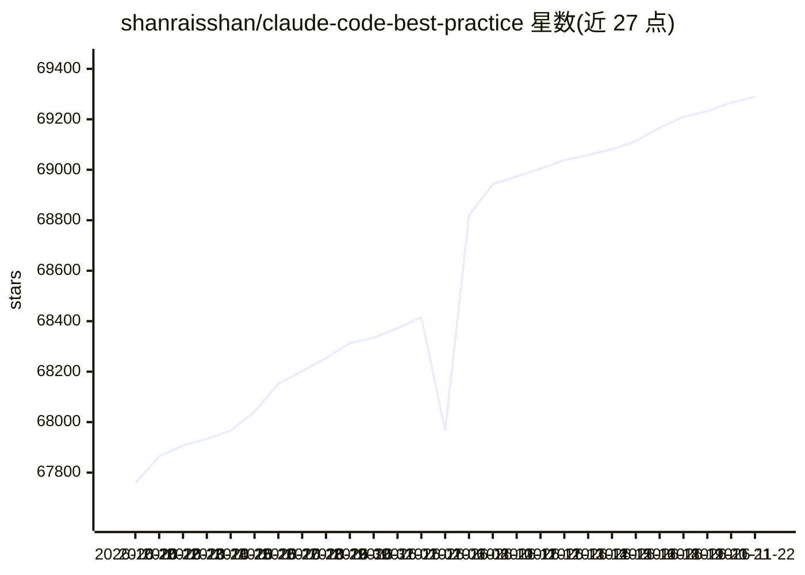

# shanraisshan/claude-code-best-practice

⭐ 69,290 · HTML · MIT · 推送 2026-11-21 · [GitHub](https://github.com/shanraisshan/claude-code-best-practice) · [官网](https://linkedin.com/in/shanraisshan) · 个人维护

**为 Claude Code 用户整理的用法概念与工作流实践清单**

该仓库汇编 Claude Code 的功能概念索引（Subagents、Commands、Skills、Hooks、MCP、Memory、Checkpointing 等条目及对应文件位置）、编排工作流（Command → Agent → Skill 模式）、十余个开发工作流方法论清单、跨模型协作机制（Plugin/MCP/Router 三类桥接方式）以及 84 条提示与技巧。面向使用 Claude Code 的开发者，内容以表格与外链形式组织，持续随版本更新；本仓库本身为文档汇编，不含可安装的运行代码。

## 筛选速览

| 维度 | 判定 | 备注 |
|---|---|---|
| AI 角色 | `ai-knowledge` | 知识聚合/清单类 |
| 许可风险 | `permissive` | MIT |
| 部署形态 | `None` |  |
| 模型依赖 | locked-api |  |
| 硬件要求 | — | 无带数字的原话,不猜 |
| 安装摩擦 | `low` | 无编译、无系统依赖或容器化 |
| 成熟度 | — | 结构信号不足 |

## 动量与使用信号

- 维护:`active` — 距上次 push 1.0 天,年发版 0,5 位贡献者
- 涨星:近 1 天 **+44**(自 20261016 起算)
- 平台:— · 协议:MCP / OLLAMA

## 能力要点

- Claude Code 各功能概念到配置文件位置的索引表
- Command → Agent → Skill 编排工作流的实现说明
- 跨模型协作的 Plugin/MCP/Router 三类机制及第三方桥接项目清单
- 84 条按主题分类的实践技巧（含来源标注）

## 适用场景

- 查阅 Claude Code 某功能应放在哪个配置文件
- 为团队挑选一套开发工作流方法论
- 让 Claude Code 配合其他模型协作开发

## 场景标签

`编码 Agent` `教程课程` · 领域:编码与开发

## 证据(README 行号)

> L20: ## 🧠 CONCEPTS
> L81: ## Orchestration Workflow
> L131: Use Claude Code together with other models — Codex, Gemini, GPT, Kimi, DeepSeek, local — via three mechanisms:

## 星数曲线

2026-10-20 67,758 → 2026-11-22 69,290（+1,532）

---
*卡片 v1 · prompt 1.4 · 生成 2026-11-22 · 置信度 high · 依据 README sha `a818e426f670` · [字段定义](../../DATASET.md)*
