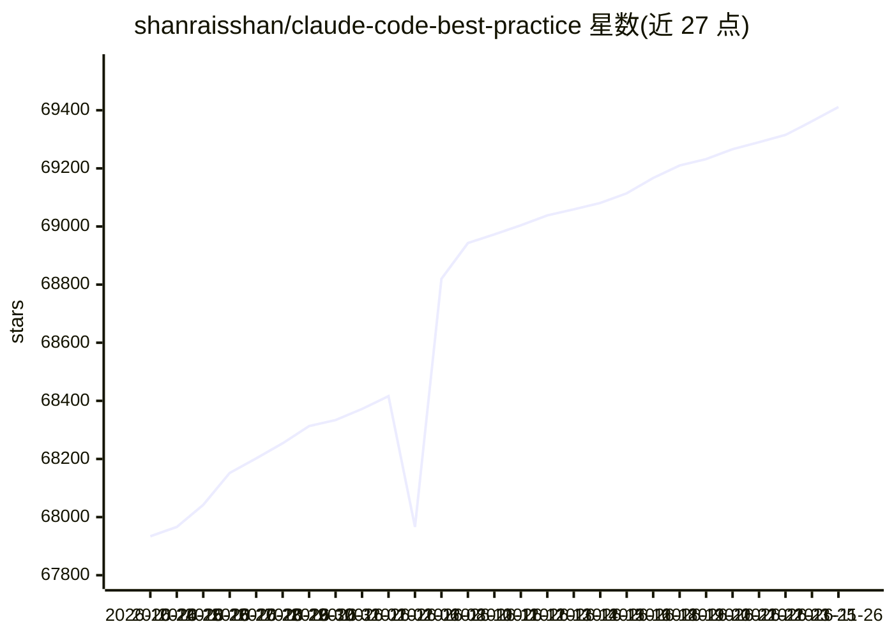

# shanraisshan/claude-code-best-practice

⭐ 69,411 · HTML · MIT · 推送 2026-11-25 · [GitHub](https://github.com/shanraisshan/claude-code-best-practice) · [官网](https://linkedin.com/in/shanraisshan) · 个人维护

**面向 Claude Code 用户的最佳实践与工作流聚合清单**

Claude Code 用法知识库：整理 Subagents/Commands/Skills/Hooks/MCP/Plugins 等特性的官方文档链接与 .claude/ 目录位置约定，收录 Command→Agent→Skill 编排工作流示例，汇总十余种社区开发工作流（Research→Plan→Execute→Review→Ship 模式）、跨模型协作机制（Plugin/MCP/Router）、技能与子代理合集清单及 84 条提示词与上下文管理技巧。使用者需自备 Claude Code，仓库本身不包含可安装的软件。

## 筛选速览

| 维度 | 判定 | 备注 |
|---|---|---|
| AI 角色 | `ai-knowledge` | 知识聚合/清单类 |
| 许可风险 | `permissive` | MIT |
| 部署形态 | `None` |  |
| 模型依赖 | — | README 未给出锁定关系 |
| 硬件要求 | — | 无带数字的原话,不猜 |
| 安装摩擦 | `low` | 无编译、无系统依赖或容器化 |
| 成熟度 | — | 结构信号不足 |

## 动量与使用信号

- 维护:`active` — 距上次 push 1.0 天,年发版 0,5 位贡献者
- 涨星:近 1 天 **+44**(自 20261016 起算)
- 平台:— · 协议:MCP / OLLAMA

## 能力要点

- 整理 Subagents/Commands/Skills/Hooks/MCP 等特性的位置与最佳实践链接
- Command→Agent→Skill 编排工作流（weather-orchestrator）示例
- 汇总 13+ 社区开发工作流与跨模型协作三机制（Plugin/MCP/Router）
- 84 条来自 Boris Cherny 等来源的使用技巧

## 适用场景

- 系统学习 Claude Code 的配置与工作流组织方式
- 为自己的项目挑选社区工作流方法论
- 查找可复用的 SKILL.md 技能合集与子代理库

## 场景标签

`提示工程` `精选清单` · 领域:Agent 开发

## 证据(README 行号)

> L1: # claude-code-best-practice
> L20: ## 🧠 CONCEPTS
> L178: ## 💡 TIPS AND TRICKS (84)

## 星数曲线

2026-10-24 67,934 → 2026-11-26 69,411（+1,477）

---
*卡片 v1 · prompt 1.4 · 生成 2026-11-26 · 置信度 high · 依据 README sha `831f679b641c` · [字段定义](../../DATASET.md)*
