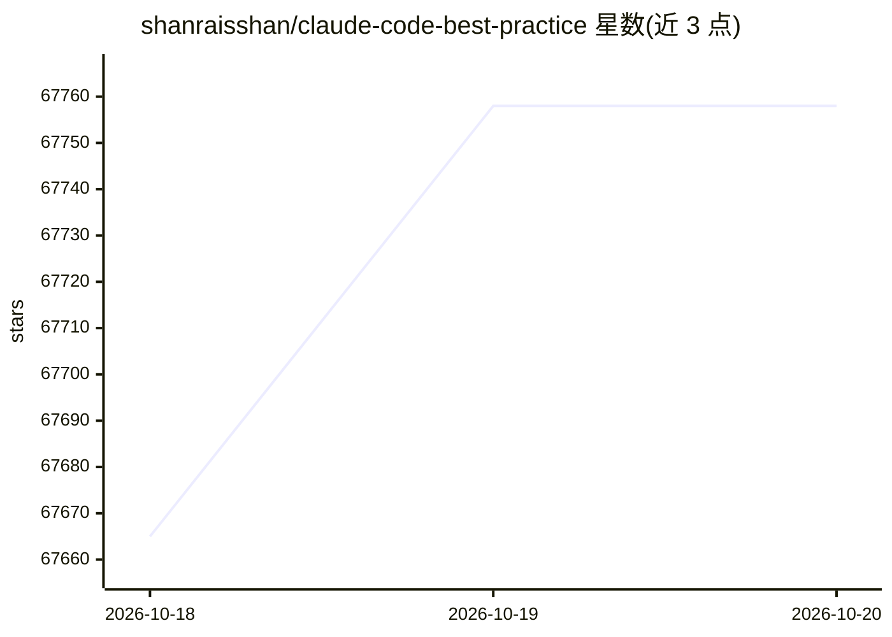

# shanraisshan/claude-code-best-practice

⭐ 67,758 · HTML · MIT · 推送 2026-10-19 · [GitHub](https://github.com/shanraisshan/claude-code-best-practice) · [官网](https://linkedin.com/in/shanraisshan) · 个人维护

**Claude Code 最佳实践与工作流策展仓库（含命令/技能/子代理参考）**

面向 Claude Code 使用者的知识策展仓库：汇总 Subagents、Commands、Skills、Hooks、MCP Servers、Memory 等功能机制的参考实现与官方文档链接，演示 Command→Agent→Skill 的编排工作流，并按星标整理 10 余个社区开发工作流方法论、跨模型（Codex/Gemini/DeepSeek/本地模型）协作的三种机制（Plugin/MCP/Router）、技能与子代理集合清单，以及 83 条来自 Boris Cherny 等使用者的提示技巧。内容以链接与表格索引为主，仓库本身不提供可安装的软件。

## 筛选速览

| 维度 | 判定 | 备注 |
|---|---|---|
| AI 角色 | `ai-knowledge` | 知识聚合/清单类 |
| 许可风险 | `permissive` | MIT |
| 部署形态 | `None` |  |
| 模型依赖 | — | README 未给出锁定关系 |
| 硬件要求 | — | 无带数字的原话,不猜 |
| 安装摩擦 | `low` | 无编译、无系统依赖或容器化 |
| 成熟度 | — | 结构信号不足 |

## 动量与使用信号

- 维护:`active` — 距上次 push 1.0 天,年发版 0,5 位贡献者
- 涨星:近 1 天 **+44**(自 20261016 起算)
- 平台:— · 协议:MCP / OLLAMA

## 能力要点

- Claude Code 各功能机制（Agents/Commands/Skills/Hooks/MCP 等）的参考实现索引
- Command→Agent→Skill 编排工作流演示（weather-orchestrator）
- 跨模型工作流机制整理：Plugin / MCP / Router 三种途径
- 83 条提示技巧与 10+ 社区开发工作流方法论清单

## 适用场景

- 系统学习 Claude Code 的功能配置与最佳实践
- 为团队挑选 agent 开发工作流方法论（如 TDD、spec 驱动流程）
- 查找 Claude Code 的技能集合、子代理定义与跨模型协作方案

## 场景标签

`精选清单` · 领域:学习与行业

## 证据(README 行号)

> L22: |Feature|Location|Description|
> L100: |Name|★|Workflow||||
> L176: ## 💡 TIPS AND TRICKS (83)

## 星数曲线

2026-10-18 67,665 → 2026-10-20 67,758（+93）

---
*卡片 v1 · prompt 1.4 · 生成 2026-10-20 · 置信度 high · 依据 README sha `4d4d95d48cfe` · [字段定义](../../DATASET.md)*
