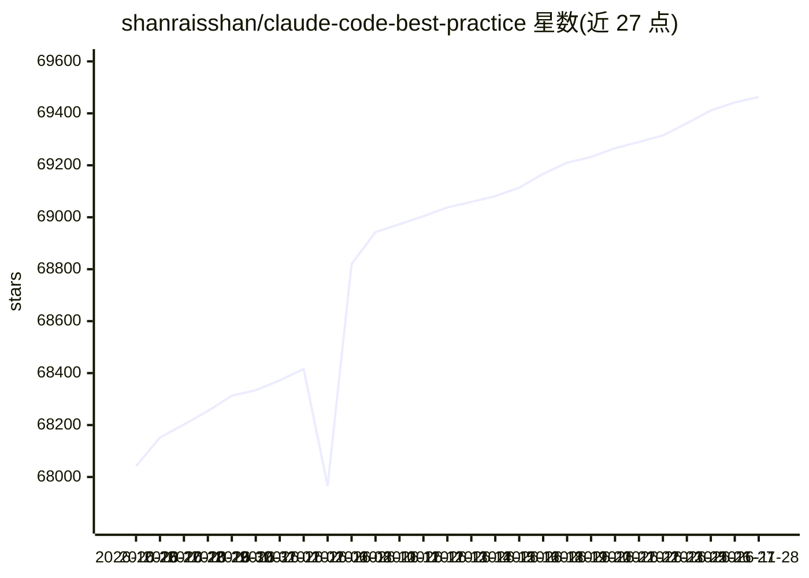

# shanraisshan/claude-code-best-practice

⭐ 69,463 · HTML · MIT · 推送 2026-11-27 · [GitHub](https://github.com/shanraisshan/claude-code-best-practice) · [官网](https://linkedin.com/in/shanraisshan) · 个人维护

**Claude Code 使用最佳实践与工作流的策展清单**

面向 Claude Code 用户的实践聚合仓库：整理 Subagents、Commands、Skills、Hooks、MCP、Memory 等机制的配置位置与用法，收录 Command→Agent→Skill 编排工作流的实现，汇总十余种社区开发工作流（Research→Plan→Execute→Review→Ship 模式）、跨模型协作机制（Plugin/MCP/Router）、技能与子代理合集仓库列表，以及 84 条来自 Boris Cherny、Thariq 等使用者的提示技巧。本体为文档清单，不提供可安装运行的产品。

## 筛选速览

| 维度 | 判定 | 备注 |
|---|---|---|
| AI 角色 | `ai-knowledge` | 知识聚合/清单类 |
| 许可风险 | `permissive` | MIT |
| 部署形态 | `None` |  |
| 模型依赖 | — | README 未给出锁定关系 |
| 硬件要求 | — | 无带数字的原话,不猜 |
| 安装摩擦 | `low` | 无编译、无系统依赖或容器化 |
| 成熟度 | — | 结构信号不足 |

## 动量与使用信号

- 维护:`active` — 距上次 push 1.0 天,年发版 0,5 位贡献者
- 涨星:近 1 天 **+44**(自 20261016 起算)
- 平台:— · 协议:MCP / OLLAMA

## 能力要点

- Claude Code 各机制（Skills/Hooks/MCP/Memory 等）的配置位置与用法索引
- Command→Agent→Skill 编排工作流的实现说明
- 跨模型工作流三种机制：Plugin、MCP、Router
- 84 条社区提示技巧（Prompting/Planning/Context 等）

## 适用场景

- 查找 Claude Code 子代理、技能与工作流的社区实现
- 为团队建立规范化的 agentic 开发流程提供参考
- 学习上下文管理与提示词方面的实践技巧

## 场景标签

`精选清单` · 领域:学习与行业

## 证据(README 行号)

> L1: # claude-code-best-practice
> L20: ## 🧠 CONCEPTS
> L150: Repos primarily known as curated libraries of `SKILL.md` files (distinct from full workflow methodologies above). 

## 星数曲线

2026-10-26 68,042 → 2026-11-28 69,463（+1,421）

---
*卡片 v1 · prompt 1.4 · 生成 2026-11-28 · 置信度 high · 依据 README sha `6b2983b959d3` · [字段定义](../../DATASET.md)*
