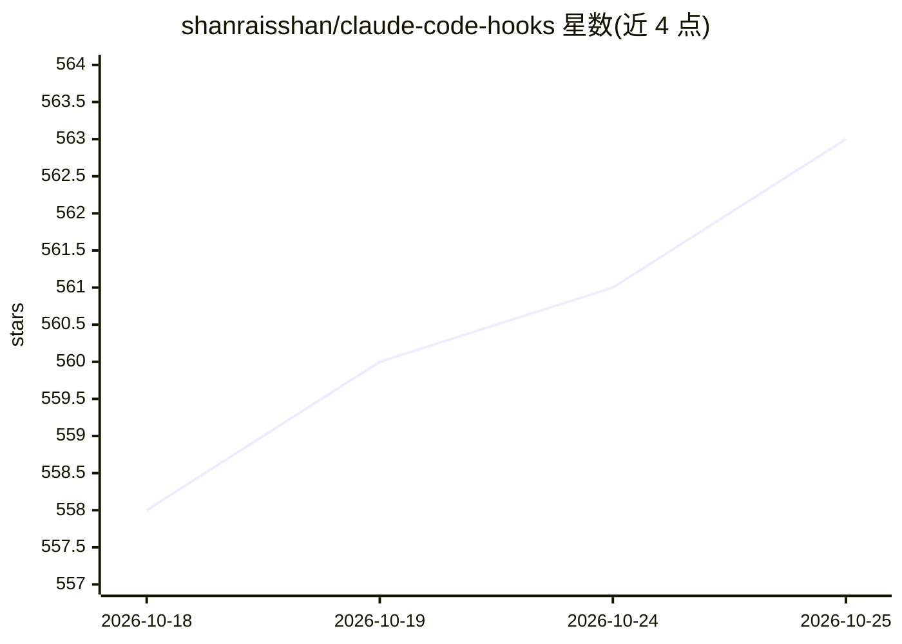

# shanraisshan/claude-code-hooks

⭐ 563 · HTML · MIT · 推送 2026-06-04 · [GitHub](https://github.com/shanraisshan/claude-code-hooks) · [官网](https://www.linkedin.com/in/shanraisshan/) · 个人维护

**为 Claude Code 各钩子事件添加提示音的 hooks 集合**

面向 Claude Code 用户的 hooks 配置仓库：在 SessionStart、PreToolUse、PostToolUse 等钩子事件触发时播放提示音——鼠标点击声对应 PreToolUse、键盘声对应 PostToolUse、人声对应其他钩子。安装按 Mac/Linux/Windows 平台区分，使用时启动 claude 并发送任意提示即可听到会话开始、工具调用、agent 回复等事件的声音。README 提供演示视频与演示文稿链接，并链接同作者的 Codex CLI/Gemini CLI hooks 与最佳实践仓库。需满足前置条件，否则会话启动时报 SessionStart hook error。

## 筛选速览

| 维度 | 判定 | 备注 |
|---|---|---|
| AI 角色 | `ai-ecosystem` | LLM/agent 周边工具 |
| 许可风险 | `permissive` | MIT |
| 部署形态 | `None` |  |
| 模型依赖 | — | README 未给出锁定关系 |
| 硬件要求 | — | 无带数字的原话,不猜 |
| 安装摩擦 | `low` | 无编译、无系统依赖或容器化 |
| 成熟度 | — | 结构信号不足 |

## 能力要点

- 覆盖会话启动、工具调用前后等钩子事件的声音提示
- 按 Mac/Linux/Windows 平台区分的安装说明
- 附带演示视频与演示文稿

## 适用场景

- 在使用 Claude Code 时通过声音感知工具调用与 agent 回复事件
- 参考 hooks 配置方式扩展 Claude Code 的事件反馈

## 场景标签

 · 领域:开发者工具/AI 编码助手扩展

## 证据(README 行号)

> L6:  Mouse click on PreToolUse, Keyboard on PostToolUse, Human voice on other hooks
> L29: **Step 2.** Send a prompt (e.g., `Hi`) — you'll hear a sound on session start, tool use, agent response, and more.

## 星数曲线

2026-10-18 558 → 2026-10-25 563（+5）

---
*卡片 v1 · prompt 1.4 · 生成 2026-10-21 · 置信度 mid · 依据 README sha `6d4371b50553` · [字段定义](../../DATASET.md)*
