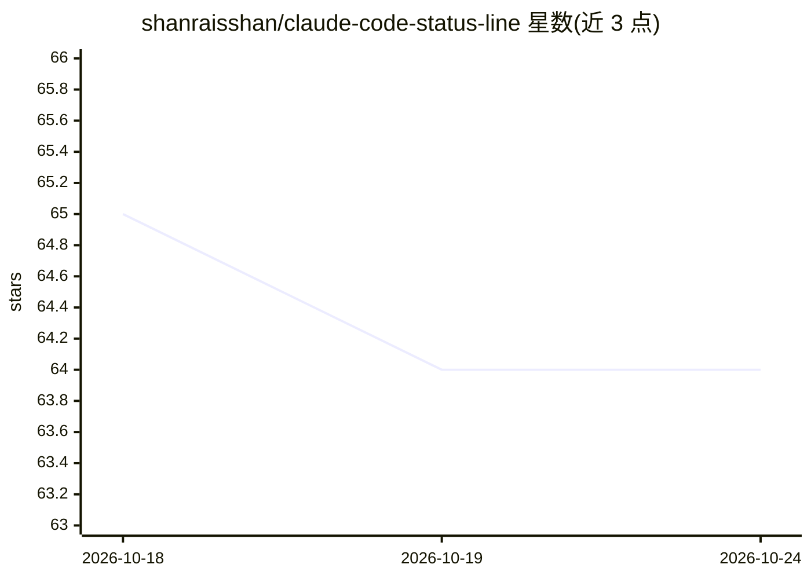

# shanraisshan/claude-code-status-line

⭐ 64 · Shell · 推送 2026-05-22 · [GitHub](https://github.com/shanraisshan/claude-code-status-line) · 个人维护

**给 Claude Code 显示上下文用量与限额的自定义状态栏脚本**

一个 Bash 脚本 status-line.sh，通过 Claude Code 的 statusLine 配置项接入，在状态栏显示当前模型（含 effort）、上下文窗口使用量（如 20k/1m，2% used）、5 小时限额与周限额的使用百分比及重置时间，并显示 git 状态。面向 Claude Code 用户。安装方式为下载脚本到 ~/.claude/scripts/ 并在 settings.json 中配置 command。README 另列出作者维护的 Claude Code / Codex CLI / Gemini CLI 最佳实践与 Hooks 等其他仓库。

## 筛选速览

| 维度 | 判定 | 备注 |
|---|---|---|
| AI 角色 | `ai-ecosystem` | LLM/agent 周边工具 |
| 许可风险 | `none` | — |
| 部署形态 | `None` |  |
| 模型依赖 | — | README 未给出锁定关系 |
| 硬件要求 | — | 无带数字的原话,不猜 |
| 安装摩擦 | `low` | 无编译、无系统依赖或容器化 |
| 成熟度 | — | 结构信号不足 |

## 能力要点

- 显示模型、上下文窗口用量与百分比
- 显示 5 小时限额与周限额用量及重置时间
- 通过 Claude Code statusLine 配置以 shell 脚本接入

## 适用场景

- 在 Claude Code 使用中实时查看上下文窗口剩余情况
- 跟踪 5 小时与每周限额的消耗和重置时间

## 场景标签

 · 领域:开发者工具/CLI

## 证据(README 行号)

> L9: Model (effort) | ○○○○○○○○○○ 20k/1m Context Window (2% used) | 5hour-Limit 1% used (ends on 05:50 AM) · Weekly-Limit 
> L35: 4. **Configure Claude Code** by adding to `~/.claude/settings.json`:

## 星数曲线

2026-10-18 65 → 2026-10-24 64（-1）

---
*卡片 v1 · prompt 1.4 · 生成 2026-10-24 · 置信度 high · 依据 README sha `546e18ba11fb` · [字段定义](../../DATASET.md)*
