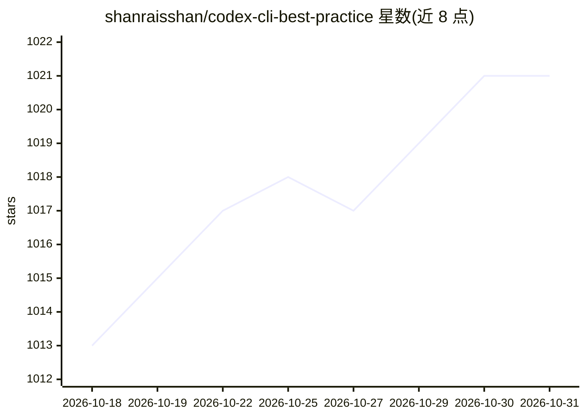

# shanraisshan/codex-cli-best-practice

⭐ 1,021 · Python · MIT · 推送 2026-06-04 · [GitHub](https://github.com/shanraisshan/codex-cli-best-practice) · [官网](https://www.linkedin.com/in/shanraisshan/) · 个人维护

**Codex CLI 使用实践与技巧合集：概念、工作流与 50 条提示**

面向 Codex CLI 用户的知识型仓库：以表格整理 Commands、Subagents、Skills、Plugins、Memories、MCP、Hooks 等概念的配置位置与用法，收录 7 套开发工作流（Superpowers、Spec Kit 等）与 50 条分 12 类的提示词、规划、AGENTS.md、多 agent 协作等技巧，并提供 Agent→Skill 的编排工作流示例（取天气数据生成 SVG 卡片）。内容为文档与示例，不含可安装的软件本体；部分功能依赖特定 Codex CLI 版本（如 Memories 需 v0.119.0+）。

## 筛选速览

| 维度 | 判定 | 备注 |
|---|---|---|
| AI 角色 | `ai-knowledge` | 知识聚合/清单类 |
| 许可风险 | `permissive` | MIT |
| 部署形态 | `None` |  |
| 模型依赖 | — | README 未给出锁定关系 |
| 硬件要求 | — | 无带数字的原话,不猜 |
| 安装摩擦 | `low` | 无编译、无系统依赖或容器化 |
| 成熟度 | `idea` | |

## 能力要点

- 以表格整理 Codex CLI 十余个概念的配置位置与用法
- 收录 7 套开发工作流与 50 条分 12 类的实践技巧
- 提供 Agent→Skill 编排工作流可运行示例（Open-Meteo 天气 → SVG 输出）
- 记录各功能所依赖的 Codex CLI 版本要求

## 适用场景

- 系统学习 Codex CLI 的 agents/skills/MCP 等功能配置
- 为团队挑选 agentic 开发工作流做参考
- 查阅提示词、规划与调试方面的实践技巧

## 场景标签

`提示工程` `编码 Agent` `教程课程` · 领域:Agent 开发

## 证据(README 行号)

> L13: |Feature|Location|Description|
> L74: Prompting · Planning · AGENTS.md · Agents · Skills · Hooks · Memories · Workflows · Advanced · Git / PR · Debugging

## 星数曲线

2026-10-18 1,013 → 2026-10-31 1,021（+8）

---
*卡片 v1 · prompt 1.4 · 生成 2026-10-21 · 置信度 high · 依据 README sha `387b7e98c507` · [字段定义](../../DATASET.md)*
