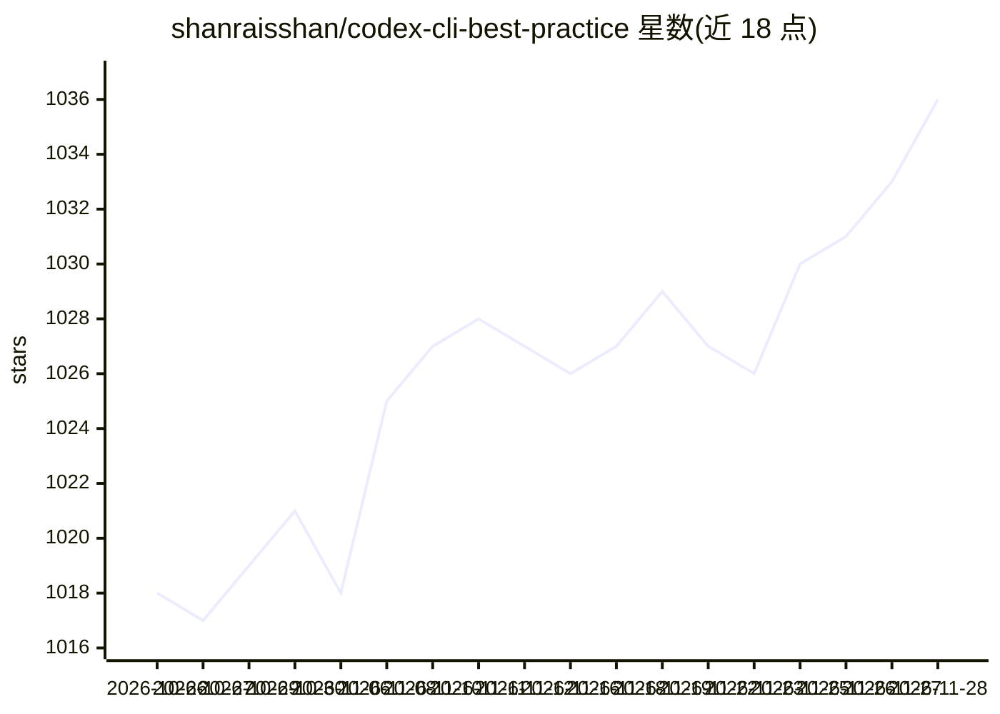

# shanraisshan/codex-cli-best-practice

⭐ 1,036 · Python · MIT · 推送 2026-11-23 · [GitHub](https://github.com/shanraisshan/codex-cli-best-practice) · [官网](https://www.linkedin.com/in/shanraisshan/) · 个人维护

**Codex CLI 的最佳实践与技巧汇编指南**

面向使用 Codex CLI 的开发者，汇总其功能概念表（commands、subagents、skills、MCP、hooks、config 等）、6 个社区工作流（Research→Plan→Execute→Review→Ship 模式）与 50 条分类技巧，覆盖提示词、规划、AGENTS.md 编写、skills 结构、hooks 用法、Git/PR、调试与日常维护。内容以表格与外部链接引用社区来源，附验证清单；自身不含安装脚本或可执行代码。

## 筛选速览

| 维度 | 判定 | 备注 |
|---|---|---|
| AI 角色 | `ai-knowledge` | 知识聚合/清单类 |
| 许可风险 | `permissive` | MIT |
| 部署形态 | `None` |  |
| 模型依赖 | — | README 未给出锁定关系 |
| 硬件要求 | — | 无带数字的原话,不猜 |
| 安装摩擦 | `low` | 无编译、无系统依赖或容器化 |
| 成熟度 | — | 结构信号不足 |

## 能力要点

- Codex CLI 功能概念表：commands、subagents、skills、MCP、hooks、memories 等
- 汇总 6 个社区工作流的命令序列与架构模式
- 50 条分类技巧，含 AGENTS.md、skills 编写与调试实践
- cross-model（Claude Code + Codex）协作工作流示例

## 适用场景

- 使用 Codex CLI 时查找对应功能的用法与命令
- 为自己的项目编写 AGENTS.md 和 skills 时参考社区经验
- 搭建多 agent 开发工作流前调研现有方案

## 场景标签

`教程课程` · 领域:学习与行业

## 证据(README 行号)

> L92: ## 💡 TIPS AND TRICKS (50)
> L13: ## 🧠 CONCEPTS

## 星数曲线

2026-10-26 1,018 → 2026-11-28 1,036（+18）

---
*卡片 v1 · prompt 1.4 · 生成 2026-11-25 · 置信度 high · 依据 README sha `829a5baea6ce` · [字段定义](../../DATASET.md)*
