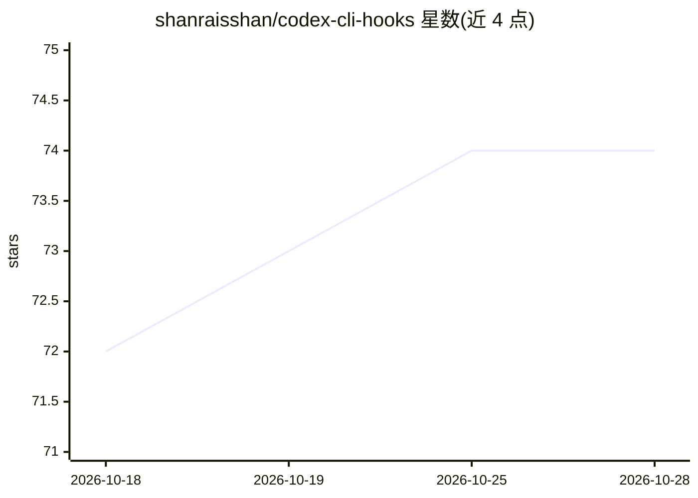

# shanraisshan/codex-cli-hooks

⭐ 74 · Python · 推送 2026-06-04 · [GitHub](https://github.com/shanraisshan/codex-cli-hooks) · [官网](https://www.linkedin.com/in/shanraisshan/) · 个人维护

**Codex CLI 钩子集合：为各事件添加提示音与上下文注入**

面向 Codex CLI 用户的 hooks 集合，覆盖 SessionStart、UserPromptSubmit、PreToolUse、PostToolUse、Stop、PreCompact 等 8 种钩子事件，在会话开始、停止、agent 回合完成时播放声音，并进行上下文注入。安装按 Mac/Linux/Windows 分别给出说明，首次使用需在 Codex CLI 中通过 /hooks 逐一信任各钩子。README 另链接到同一维护者的 Claude Code Hooks 与 Gemini CLI Hooks 仓库。

## 筛选速览

| 维度 | 判定 | 备注 |
|---|---|---|
| AI 角色 | `ai-ecosystem` | LLM/agent 周边工具 |
| 许可风险 | `none` | — |
| 部署形态 | `None` |  |
| 模型依赖 | — | README 未给出锁定关系 |
| 硬件要求 | — | 无带数字的原话,不猜 |
| 安装摩擦 | `low` | 无编译、无系统依赖或容器化 |
| 成熟度 | — | 结构信号不足 |

## 能力要点

- 支持 8 种 Codex CLI 钩子事件
- 会话开始/停止、agent 回合完成时播放提示音
- 提供上下文注入能力
- 分 Mac/Linux/Windows 三平台安装说明

## 适用场景

- 在 Codex CLI 编码会话中通过声音获知事件状态
- 在钩子事件节点注入上下文信息

## 场景标签

 · 领域:开发者工具/CLI 扩展

## 证据(README 行号)

> L6:  Human sounds on session start, stop, and agent turn complete, context injection
> L8:  Supported hooks: SessionStart, UserPromptSubmit, PreToolUse, PermissionRequest, PostToolUse, Stop, PreCompact, Post

## 星数曲线

2026-10-18 72 → 2026-10-28 74（+2）

---
*卡片 v1 · prompt 1.4 · 生成 2026-10-24 · 置信度 mid · 依据 README sha `991ef1d606d9` · [字段定义](../../DATASET.md)*
