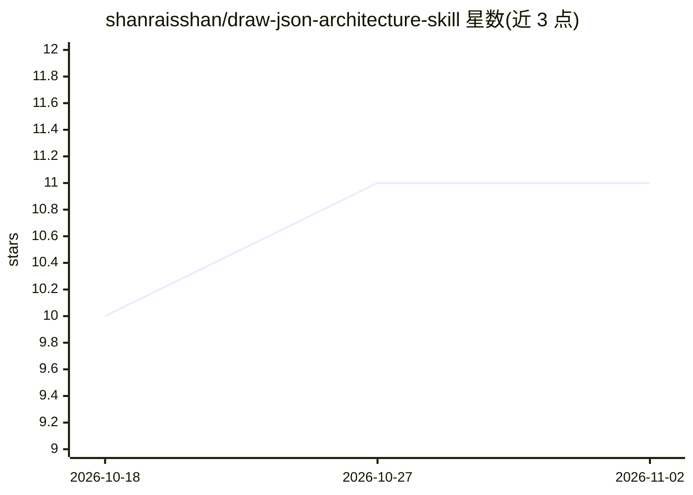

# shanraisshan/draw-json-architecture-skill

⭐ 11 · HTML · 推送 2026-06-01 · [GitHub](https://github.com/shanraisshan/draw-json-architecture-skill) · [官网](https://www.linkedin.com/in/shanraisshan/) · 个人维护

**为编码 agent 提供的架构图技能：按流程生成交互式 HTML 查看器**

一个面向 Claude Code 与 Codex CLI 的 agent 技能（skill）：用户定义要解释的代码流程（如 home 到下单）与观察视角（ui/api/database/auth/cache/queue/llm 等），技能逐站生成由 JSON 驱动的自包含 architecture viewer HTML 文件（Graph + JSON + HTML 三面板），保存到仓库根目录 architecture/ 文件夹，并在交付前校验链接与生成产物。通过 Claude 的 /draw-json-architecture 或 Codex 的 $draw-json-architecture 命令调用。

## 筛选速览

| 维度 | 判定 | 备注 |
|---|---|---|
| AI 角色 | `ai-ecosystem` | LLM/agent 周边工具 |
| 许可风险 | `none` | — |
| 部署形态 | `None` |  |
| 模型依赖 | locked-api |  |
| 硬件要求 | — | 无带数字的原话,不猜 |
| 安装摩擦 | `low` | 无编译、无系统依赖或容器化 |
| 成熟度 | — | 结构信号不足 |

## 能力要点

- 按用户定义的流程逐站生成架构解释
- 多种视角镜头（ui/api/database/auth/cache/queue/llm 等）并为各视角配色
- 生成由 JSON 驱动的自包含 HTML 查看器并自动校验链接与产物
- 同时支持 Claude Code 与 Codex CLI 调用

## 适用场景

- 让编码 agent 生成仓库架构的交互式可视化文档
- 按特定业务流程（如首页到下单）解释代码路径
- 按 ui/api/database 等视角分层查看架构

## 场景标签

 · 领域:开发者工具/代码架构可视化

## 证据(README 行号)

> L5: A skill that explains any code architecture as an interactive viewer — Graph + JSON + HTML, 100% driven by JSON — an
> L21: /draw-json-architecture <flow>
> L26: $draw-json-architecture <flow>

## 星数曲线

2026-10-18 10 → 2026-11-02 11（+1）

---
*卡片 v1 · prompt 1.4 · 生成 2026-11-01 · 置信度 high · 依据 README sha `23ea5a6d82ab` · [字段定义](../../DATASET.md)*
