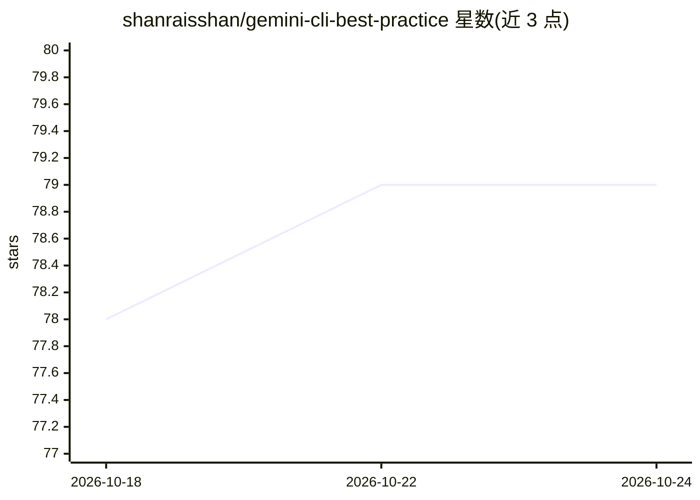

# shanraisshan/gemini-cli-best-practice

⭐ 79 · Python · MIT · 推送 2026-05-26 · [GitHub](https://github.com/shanraisshan/gemini-cli-best-practice) · [官网](https://linkedin.com/in/shanraisshan) · 个人维护

**Gemini CLI 最佳实践与技巧策展仓库：概念表、工作流与 29+ 条提示**

面向 Gemini CLI 使用者的实践参考汇编：以表格梳理 Subagents、Agent Skills、Commands、MCP、Extensions、Memory 等概念的位置与用法，给出 Command→Agent→Skill 编排工作流示例（weather-orchestrator），并收录 9 套社区开发工作流（Superpowers、Spec Kit 等）与按记忆、代理、技能、安全、自动化等主题组织的 29+ 条技巧，多数标注来源（Gemini 官方/Taylor Mullen/Addy Osmani）。内容为文档型策展，不提供本仓库自身的安装包或代码入口。

## 筛选速览

| 维度 | 判定 | 备注 |
|---|---|---|
| AI 角色 | `ai-knowledge` | 知识聚合/清单类 |
| 许可风险 | `permissive` | MIT |
| 部署形态 | `None` |  |
| 模型依赖 | — | README 未给出锁定关系 |
| 硬件要求 | — | 无带数字的原话,不猜 |
| 安装摩擦 | `medium` | 含编译或系统依赖之一 |
| 成熟度 | — | 结构信号不足 |

## 能力要点

- 概念表覆盖 Subagents/Skills/Commands/MCP/Extensions/Memory 等机制及文件位置
- Command→Agent→Skill 编排工作流示例（weather-orchestrator TOML）
- 收录 9 套社区开发工作流与 29+ 条带来源标注的技巧

## 适用场景

- 查阅 Gemini CLI 各机制（子代理、技能、命令）的用法与文件路径
- 参考社区开发工作流设计自己的 agent 流程
- 学习上下文管理、安全沙箱与 CI 自动化等配置技巧

## 场景标签

`精选清单` · 领域:学习与行业

## 证据(README 行号)

> L13: |Feature|Location|Description|
> L15: |**Subagents**|`.gemini/agents/<name>.md`|Best Practice Implemented Specialized actors with isolated context, scope
> L92: ## 💡 TIPS AND TRICKS (29+)

## 星数曲线

2026-10-18 78 → 2026-10-24 79（+1）

---
*卡片 v1 · prompt 1.4 · 生成 2026-10-24 · 置信度 high · 依据 README sha `f41ae82683b5` · [字段定义](../../DATASET.md)*
