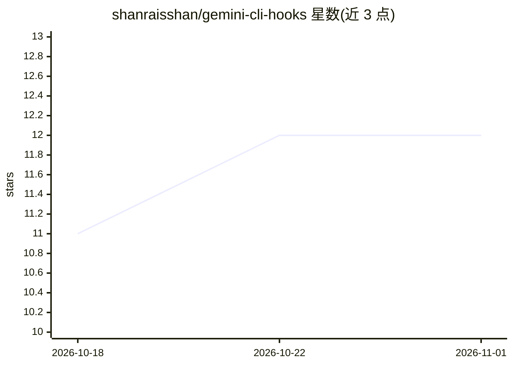

# shanraisshan/gemini-cli-hooks

⭐ 12 · Python · MIT · 推送 2026-05-26 · [GitHub](https://github.com/shanraisshan/gemini-cli-hooks) · [官网](https://linkedin.com/in/shanraisshan) · 个人维护

**为 Gemini CLI 各钩子事件添加语音提醒的工具**

面向 Gemini CLI 使用者的 hooks 扩展：在会话启动、工具调用、agent 回应、模型与工具生命周期等每个钩子事件触发时播放声音通知。安装后随 Gemini CLI 启动自动生效，发送提示词即可在会话开始、工具使用、agent 回应等时机听到声音。依赖 Python 3，脚本位于项目内 .gemini/hooks/scripts/hooks.py；缺少前置条件时 CLI 启动会报 SessionStart hook error。同一维护者还提供 Claude Code、Codex CLI 的同类 hooks 仓库。

## 筛选速览

| 维度 | 判定 | 备注 |
|---|---|---|
| AI 角色 | `ai-ecosystem` | LLM/agent 周边工具 |
| 许可风险 | `permissive` | MIT |
| 部署形态 | `None` |  |
| 模型依赖 | — | README 未给出锁定关系 |
| 硬件要求 | — | 无带数字的原话,不猜 |
| 安装摩擦 | `low` | 无编译、无系统依赖或容器化 |
| 成熟度 | — | 结构信号不足 |

## 能力要点

- 覆盖会话、agent、模型、工具生命周期各钩子事件的声音通知
- Mac/Linux/Windows 三平台提供安装途径
- 前置条件校验指引（Python 3 与 hooks.py 脚本）

## 适用场景

- 在 Gemini CLI 长时间任务中通过声音获知工具调用与 agent 回应进度
- 多平台开发环境中为 CLI agent 事件配置提醒

## 场景标签

 · 领域:开发者工具/CLI 扩展

## 证据(README 行号)

> L1: # Gemini CLI Hooks
> L6:  Sound notifications for every Gemini CLI hook event — session, agent, model, and tool lifecycle

## 星数曲线

2026-10-18 11 → 2026-11-01 12（+1）

---
*卡片 v1 · prompt 1.4 · 生成 2026-11-01 · 置信度 high · 依据 README sha `ffc9e8efaaa1` · [字段定义](../../DATASET.md)*
