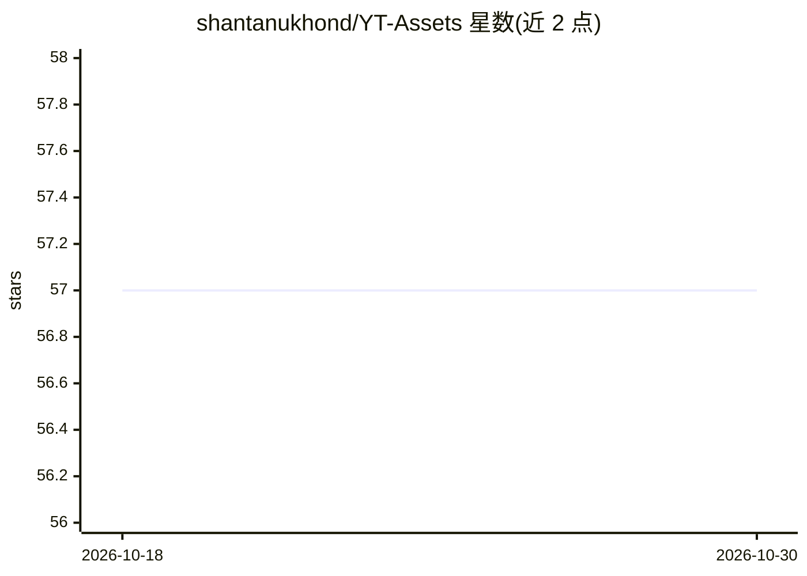

# shantanukhond/YT-Assets

⭐ 57 · HCL · 推送 2026-08-18 · [GitHub](https://github.com/shantanukhond/YT-Assets) · [官网](https://www.youtube.com/@shantanukhond) · 个人维护

**YouTube 数据分析教学频道的代码与资源配套清单**

配套 YouTube 频道的资源仓库：按 Apache Superset 安装配置、SQL Lab、仪表盘、嵌入集成、企业架构、Docker 镜像等主题组织视频链接，另含 Valkey 安装、ChatGPT AI Agent 入门（PRIMER）、PostgreSQL/pgvector 向量数据库等主题条目。仓库本身提供的是视频索引与配套代码/产物的入口，并附规划视频的 Google Sheet 与建议表单。适合跟随视频学习 BI 报表、SQL 与数据可视化的人群。

## 筛选速览

| 维度 | 判定 | 备注 |
|---|---|---|
| AI 角色 | `ai-knowledge` | 知识聚合/清单类 |
| 许可风险 | `none` | — |
| 部署形态 | `None` |  |
| 模型依赖 | — | README 未给出锁定关系 |
| 硬件要求 | — | 无带数字的原话,不猜 |
| 安装摩擦 | `low` | 无编译、无系统依赖或容器化 |
| 成熟度 | — | 结构信号不足 |

## 能力要点

- Apache Superset 系列视频索引（安装、配置、SQL Lab、仪表盘、嵌入 React/Angular）
- 覆盖 Superset 企业架构与 Redis/Celery 部署、Docker 自定义镜像主题
- 附带 Valkey、PostgreSQL/pgvector、ChatGPT AI Agent 等扩展主题条目

## 适用场景

- 跟视频学习 Apache Superset 的安装、配置与仪表盘开发
- 查找 Superset 嵌入 Web 应用与企业级部署的教程
- 通过规划视频表单建议想看的教程主题

## 场景标签

`教程课程` · 领域:学习与行业

## 证据(README 行号)

> L1: ## 📊 Learn Reporting, SQL, Coding, and DataViz - Resources for YouTube Channel YouTube Channel
> L13: 1. **Apache Superset** YouTube Playlist
> L37: 1. Ai Agent with ChatGpt

## 星数曲线

2026-10-18 57 → 2026-10-30 57（+0）

---
*卡片 v1 · prompt 1.4 · 生成 2026-10-24 · 置信度 mid · 依据 README sha `9bfd24d0f5d7` · [字段定义](../../DATASET.md)*
