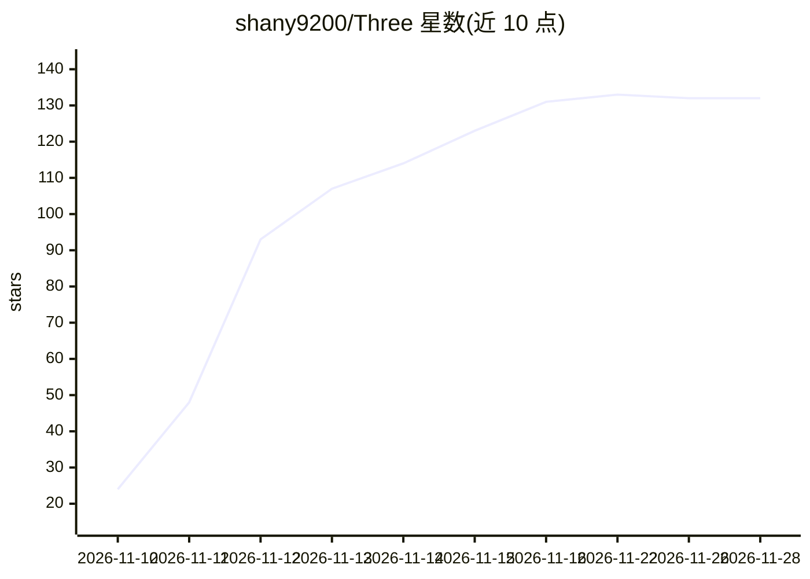

# shany9200/Three

⭐ 132 · Python · MIT · 推送 2026-11-10 · [GitHub](https://github.com/shany9200/Three) · 个人维护 · 中文 README

**可在 Termux 手机上运行的自扩展 AI agent，具备跨会话记忆**

基于 Python 单文件的 LLM agent，面向在 Android 手机、平板、旧笔记本等 Termux 可运行的环境中使用。核心机制：双层记忆（人类撰写并全量注入 system prompt 的经验库 + 记录事实的日记，重启后作启动回忆）；通过标签注册机制插入新能力，agent 可自主读取自身源码、编写并注册新函数；内置 CMD 执行 LLM 生成的 shell 命令（无沙箱、无确认）与 SELF_EDIT 自编辑（自动备份、ast 校验、失败回滚）。依赖 Python 3 与 requests，通过 OPENAI_API_KEY 等环境变量接入 OpenAI 兼容 API，默认 deepseek-chat。

## 筛选速览

| 维度 | 判定 | 备注 |
|---|---|---|
| AI 角色 | `ai-native` | 本体是模型或模型工具 |
| 许可风险 | `permissive` | MIT |
| 部署形态 | `library` | 以包/库形式分发 |
| 模型依赖 | — | README 未给出锁定关系 |
| 硬件要求 | — | 无带数字的原话,不猜 |
| 安装摩擦 | `low` | 无编译、无系统依赖或容器化 |
| 成熟度 | — | 结构信号不足 |

## 能力要点

- 双层记忆：人类撰写的经验库全量注入 prompt + 日记式启动回忆
- 能力标签注册机制，agent 可自主编写并注册新能力
- SELF_EDIT 自我编辑：备份、ast 校验、失败回滚
- 单文件 Python 实现，在 Termux 手机上即可运行

## 适用场景

- 在 Android 手机上离身运行一个带记忆的个人 AI 助手
- 通过对话让 agent 代替我执行终端命令和文件操作
- 观察/实验具备自我扩展与自编辑能力的 agent 架构

## 场景标签

`AI 助手` `Agent 记忆` · 领域:Agent 开发

## 证据(README 行号)

> L3: A self-extending AI agent that runs anywhere Termux runs — phones, tablets,
> L19: - **Memory continuity**: the lesson library is fully loaded into the system prompt, and the diary takes the most re

## 星数曲线

2026-11-10 24 → 2026-11-28 132（+108）

---
*卡片 v1 · prompt 1.4 · 生成 2026-11-17 · 置信度 mid · 依据 README sha `1a4430ecec73` · [字段定义](../../DATASET.md)*
