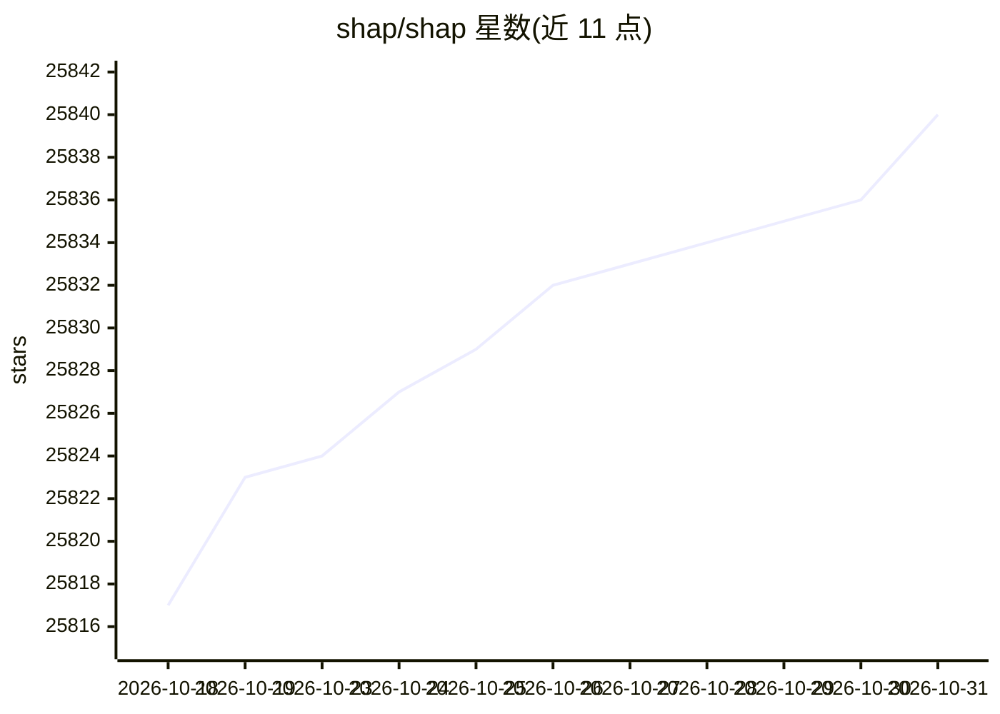

# shap/shap

⭐ 25,840 · Jupyter Notebook · MIT · 推送 2026-10-30 · [GitHub](https://github.com/shap/shap) · [官网](https://shap.readthedocs.io) · 组织维护

**给机器学习模型输出提供 Shapley 值解释的 Python 库**

基于博弈论 Shapley 值，为任意机器学习模型的输出计算特征归因（SHAP 值），并提供 force plot、beeswarm、scatter、bar、dependence plot 等可视化接口。针对不同模型类型提供多种解释器：TreeExplainer（树模型精确高速 C++ 实现）、DeepExplainer 与 GradientExplainer（TensorFlow/Keras/PyTorch 深度模型近似）、LinearExplainer（线性模型）、KernelExplainer（模型无关）。以 Python 包形式发布，支持 PyPI 与 conda-forge 安装，可选 CUDA extra 启用 GPU 加速的 Tree SHAP。

## 筛选速览

| 维度 | 判定 | 备注 |
|---|---|---|
| AI 角色 | `ai-ecosystem` | LLM/agent 周边工具 |
| 许可风险 | `permissive` | MIT |
| 部署形态 | `library` | 以包/库形式分发 |
| 模型依赖 | — | README 未给出锁定关系 |
| 硬件要求 | — | 无带数字的原话,不猜 |
| 安装摩擦 | `medium` | 含编译或系统依赖之一 |
| 成熟度 | — | 结构信号不足 |

## 动量与使用信号

- 维护:`active` — 距上次 push 2.0 天,年发版 6,276 位贡献者
- 涨星:近 1 天 **+2**(自 20261016 起算)
- 安装:pypi 包 `shap` 月下载 8,756,041

## 能力要点

- TreeExplainer 对 XGBoost/LightGBM/CatBoost/scikit-learn/pyspark 树模型提供 C++ 精确算法
- DeepExplainer/GradientExplainer 支持 TensorFlow/Keras/PyTorch 深度模型
- KernelExplainer 为模型无关方法，可解释任意函数
- TreeExplainer 支持 SHAP interaction values 的成对交互精确计算

## 适用场景

- 解释树集成模型（如 XGBoost）每个特征对预测的贡献
- 可视化深度学习模型（如图像分类）的输入归因
- 分析特征交互与特征重要性排序
- 对 NLP transformers 模型输出做特征归因解释

## 场景标签

 · 领域:机器学习/模型可解释性

## 证据(README 行号)

> L10: **SHAP (SHapley Additive exPlanations)** is a game theoretic approach to explain the output of any machine learning
> L40: While SHAP can explain the output of any machine learning model, we have developed a high-speed exact algorithm for

## 星数曲线

2026-10-18 25,817 → 2026-10-31 25,840（+23）

---
*卡片 v1 · prompt 1.4 · 生成 2026-10-18 · 置信度 high · 依据 README sha `0798f75890c5` · [字段定义](../../DATASET.md)*
