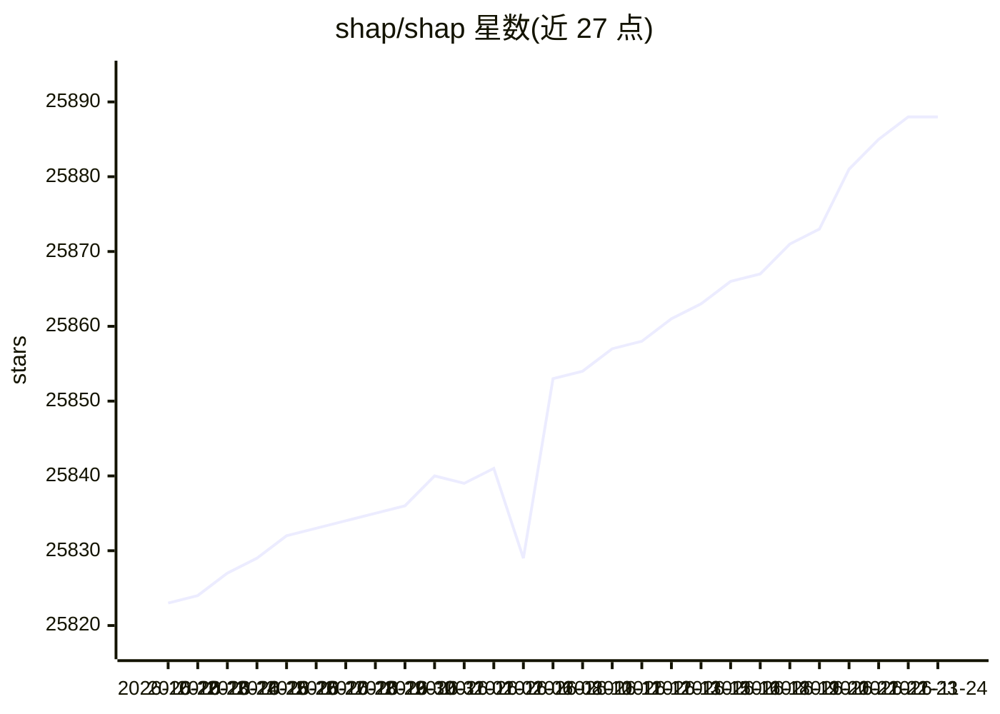

# shap/shap

⭐ 25,892 · Jupyter Notebook · MIT · 推送 2026-11-23 · [GitHub](https://github.com/shap/shap) · [官网](https://shap.readthedocs.io) · 组织维护

**给机器学习模型输出做 Shapley 值归因解释的 Python 库**

SHAP 基于博弈论 Shapley 值解释任意机器学习模型的输出，将最优信用分配与局部解释结合。针对树集成模型提供 C++ 高速精确算法（支持 XGBoost/LightGBM/CatBoost/scikit-learn/pyspark），针对深度模型提供 DeepExplainer（TensorFlow/Keras）与 GradientExplainer（TF/Keras/PyTorch），并提供模型无关的 KernelExplainer；对 Hugging Face transformers NLP 模型有专门支持。提供 force plot、beeswarm、scatter、bar 等可视化绘图，附多套示例 notebook。经 PyPI 或 conda-forge 安装，GPU 加速由独立 shap-cuda 包提供。

## 筛选速览

| 维度 | 判定 | 备注 |
|---|---|---|
| AI 角色 | `ai-native` | 本体是模型或模型工具 |
| 许可风险 | `permissive` | MIT |
| 部署形态 | `library` | 以包/库形式分发 |
| 模型依赖 | — | README 未给出锁定关系 |
| 硬件要求 | — | 无带数字的原话,不猜 |
| 安装摩擦 | `medium` | 含编译或系统依赖之一 |
| 成熟度 | — | 结构信号不足 |

## 动量与使用信号

- 维护:`active` — 距上次 push 2.0 天,年发版 6,276 位贡献者
- 涨星:近 1 天 **+2**(自 20261016 起算)
- 安装:pypi 包 `shap` 月下载 8,756,041

## 能力要点

- 树模型高速精确的 Tree SHAP 算法，覆盖 5 种树框架
- DeepExplainer/GradientExplainer 支持 TensorFlow/Keras/PyTorch 深度模型
- KernelExplainer 模型无关方法可解释任意函数
- SHAP interaction values 计算成对特征交互效应

## 适用场景

- 解释 XGBoost/LightGBM 模型的特征贡献
- 可视化深度学习模型的输入归因（如图像像素）
- 解释 Hugging Face transformers 文本模型的输出
- 分析特征交互与生存/风险模型

## 场景标签

 · 领域:机器学习/可解释性工具

## 证据(README 行号)

> L10: **SHAP (SHapley Additive exPlanations)** is a game theoretic approach to explain the output of any machine learning
> L43: While SHAP can explain the output of any machine learning model, we have developed a high-speed exact algorithm for

## 星数曲线

2026-10-22 25,823 → 2026-11-24 25,888（+65）

---
*卡片 v1 · prompt 1.4 · 生成 2026-11-22 · 置信度 high · 依据 README sha `5ee828dea567` · [字段定义](../../DATASET.md)*
