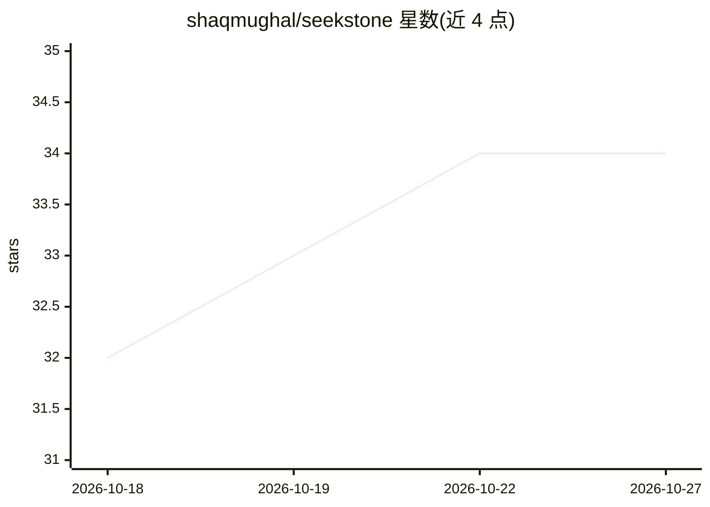

# shaqmughal/seekstone

⭐ 34 · TypeScript · MIT · 推送 2026-10-25 · [GitHub](https://github.com/shaqmughal/seekstone) · [官网](https://seekstone.dev) · 个人维护

**直读 Obsidian 库的 MCP 服务器：为 AI 客户端提供毫秒级笔记检索**

面向 Claude 等 MCP 客户端的 Obsidian 笔记库服务器：绕过 Obsidian 应用与 Local REST 插件，直接从磁盘读取 vault 并在进程内维护全文索引，提供 25 个工具。搜索分三种模式：全文/模糊检索（热查询毫秒级）、可选的本地语义检索（一次性下载约 30 MB 嵌入模型后离线运行）、以及按 frontmatter 属性/标签/时间过滤的结构化查询。返回约 2 KB 的排序摘录而非全文，README 附带 8 个服务器的可复现基准。以 npm 包发布，也提供 Claude Desktop 一键安装的 .mcpb 包；CLI 方式需 Node.js ≥ 22。

## 筛选速览

| 维度 | 判定 | 备注 |
|---|---|---|
| AI 角色 | `ai-ecosystem` | LLM/agent 周边工具 |
| 许可风险 | `permissive` | MIT |
| 部署形态 | `library` | 以包/库形式分发 |
| 模型依赖 | — | README 未给出锁定关系 |
| 硬件要求 | — | 无带数字的原话,不猜 |
| 安装摩擦 | `low` | 无编译、无系统依赖或容器化 |
| 成熟度 | — | 结构信号不足 |

## 能力要点

- 无需 Obsidian 应用与插件，文件系统直读 vault
- 三种搜索模式：全文、可选本地语义（约 26 ms）、结构化 frontmatter 查询
- 返回约 2 KB 排序摘录，25 个 MCP 工具
- 提供 8 个服务器、3 种库规模的可复现基准测试

## 适用场景

- 让 Claude Desktop/Cursor/VS Code 直接检索和读写我的 Obsidian 笔记库
- 大库（上万条笔记）下低延迟、小负载地搜索笔记
- 按标签、日期、frontmatter 属性批量筛选笔记

## 场景标签

`知识库管理` `语义搜索` · 领域:知识与检索

## 证据(README 行号)

> L43: **Seekstone is an Obsidian MCP server** — it gives Claude (and any Model Context Protocol client) direct read and w
> L50: Search comes in three modes: ranked **full-text search** (fuzzy and prefix matching), optional **local semantic sea

## 星数曲线

2026-10-18 32 → 2026-10-27 34（+2）

---
*卡片 v1 · prompt 1.4 · 生成 2026-10-25 · 置信度 high · 依据 README sha `d70141e06845` · [字段定义](../../DATASET.md)*
