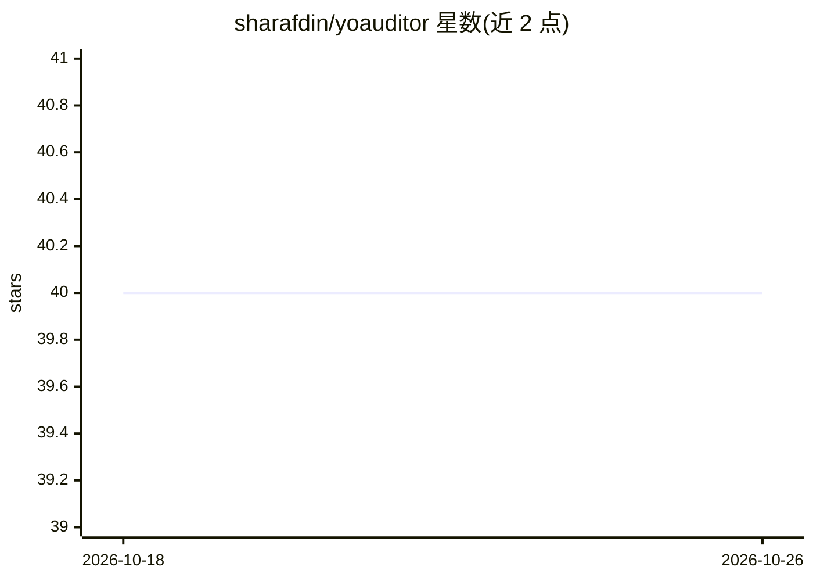

# sharafdin/yoauditor

⭐ 40 · Rust · MIT · 推送 2026-02-18 · [GitHub](https://github.com/sharafdin/yoauditor) · 个人维护

**用本地 LLM 审计 GitHub 仓库代码的 Rust CLI 工具**

用 Rust 编写的命令行代码审计工具，通过本地 LLM 后端（Ollama 或 llama.cpp server）分析 GitHub 仓库或本地代码，检测安全漏洞、逻辑错误、空指针风险与性能问题。提供两种模式：单次调用把所有文件一次发给模型，或工具调用（agentic）模式让模型自主浏览文件、读取、搜索并逐条报告问题。生成 Markdown/JSON 报告，支持 --fail-on 退出码门禁接入 CI，可用 .yoauditor.toml 配置模型与排除项。安装方式为源码编译或 Docker 构建。

## 筛选速览

| 维度 | 判定 | 备注 |
|---|---|---|
| AI 角色 | `ai-native` | 本体是模型或模型工具 |
| 许可风险 | `permissive` | MIT |
| 部署形态 | `self-host` | docker 或自建部署 |
| 模型依赖 | local-ok | 支持本地模型 |
| 硬件要求 | — | 无带数字的原话,不猜 |
| 安装摩擦 | `low` | 无编译、无系统依赖或容器化 |
| 成熟度 | — | 结构信号不足 |

## 能力要点

- 单次调用与工具调用（agentic）两种审计模式
- 检测安全漏洞、逻辑错误、空指针、竞态条件与性能问题
- 生成含行号的 Markdown/JSON 报告，--fail-on 退出码支持 CI 门禁
- 内置含已知缺陷代码的 fixtures 用于测试与模型对比

## 适用场景

- 我在 CI 流水线里按严重度门禁拦截有漏洞的提交
- 我想用本地 Ollama 模型离线扫描仓库的安全问题
- 我想对比不同本地/云端模型在代码审计上的表现

## 场景标签

`代码审查` · 领域:编码与开发

## 证据(README 行号)

> L3: LLM-powered code auditor for GitHub repos. Audit any repo for bugs, security issues, and performance problems using 
> L25: - 🤖 **Agentic Analysis**: LLM autonomously explores and analyzes the codebase
> L27: - 🔒 **Security Scanning**: Identifies potential security vulnerabilities

## 星数曲线

2026-10-18 40 → 2026-10-26 40（+0）

---
*卡片 v1 · prompt 1.4 · 生成 2026-10-25 · 置信度 high · 依据 README sha `7ce6dfeb56e7` · [字段定义](../../DATASET.md)*
