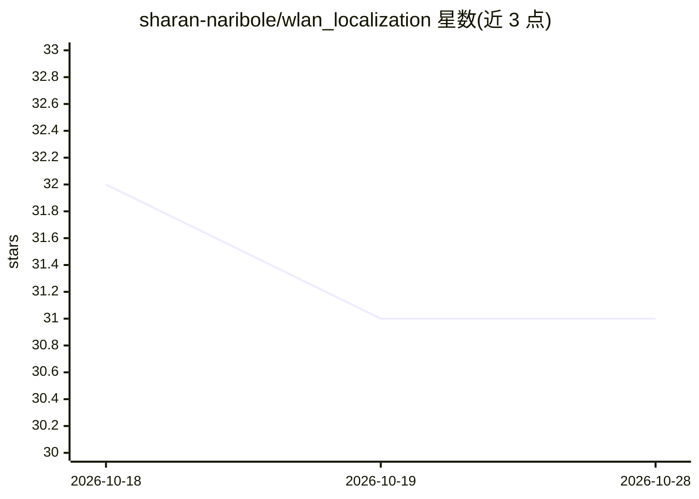

# sharan-naribole/wlan_localization

⭐ 31 · Jupyter Notebook · MIT · 推送 2026-01-16 · [GitHub](https://github.com/sharan-naribole/wlan_localization) · 个人维护

**基于 Wi-Fi 指纹的室内定位机器学习系统**

面向 Wi-Fi 指纹室内定位的 Python 机器学习系统，采用三阶段级联架构：随机森林分类建筑、加权 KNN 分类楼层、加权 KNN 回归经纬度，在 UJIIndoorLoc 基准数据集上实现 2.6-8.2m RMSE 定位精度。数据处理包含缺失值处理、PCA 降维（520→150 特征）与 Box-Cox 变换。提供 Python API、CLI 与 Jupyter 笔记本，实验通过 MLflow 跟踪、Optuna 调参。CPU 训练约 15 分钟，推理单次 <10ms。

## 筛选速览

| 维度 | 判定 | 备注 |
|---|---|---|
| AI 角色 | `ai-native` | 本体是模型或模型工具 |
| 许可风险 | `permissive` | MIT |
| 部署形态 | `None` |  |
| 模型依赖 | — | README 未给出锁定关系 |
| 硬件要求 | — | 无带数字的原话,不猜 |
| 安装摩擦 | `low` | 无编译、无系统依赖或容器化 |
| 成熟度 | — | 结构信号不足 |

## 能力要点

- 三阶段级联架构：建筑分类→楼层分类→位置回归
- UJIIndoorLoc 数据集上 2.65-8.17m RMSE 定位精度
- PCA 降维（520 AP→150 成分）与 Box-Cox 变换处理 96% 稀疏 RSSI 数据
- 提供 CLI、Python API、MLflow 实验跟踪与嵌套交叉验证

## 适用场景

- 机场、商场、医院等室内环境的 Wi-Fi 定位
- 仓库设备与库存实时追踪
- 室内定位研究在 UJIIndoorLoc 基准上的复现与实验

## 场景标签

 · 领域:定位/机器学习

## 证据(README 行号)

> L7: A production-ready machine learning system for Wi-Fi fingerprint-based indoor positioning using a novel cascaded arc
> L51: ### Cascaded ML Architecture

## 星数曲线

2026-10-18 32 → 2026-10-28 31（-1）

---
*卡片 v1 · prompt 1.4 · 生成 2026-10-26 · 置信度 high · 依据 README sha `7c69ffe422ba` · [字段定义](../../DATASET.md)*
