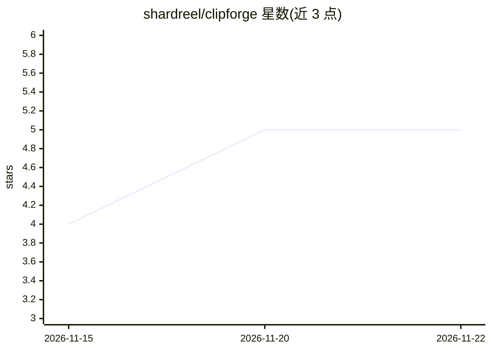

# shardreel/clipforge

⭐ 5 · Rust · MIT · 推送 2026-11-19 · [GitHub](https://github.com/shardreel/clipforge) · [官网](https://shardreel.com) · 个人维护

**本地把长游戏录像切成 9:16 竖版短视频的工具**

Rust 编写的本地流水线：将长游戏录像转为 Shorts/Reels/TikTok 竖版片段。处理链为 whisper.cpp 转录（Mac Metal/Linux CPU）、硬视频编码、基于响度尖峰/画面动作/语速检测时刻、逐词高亮字幕（libass），可选调用 LLM 对候选片段重排并生成标题。本地 Web UI 展示进度，无云服务与订阅。启动时检查磁盘/内存/CPU/GPU，Linux 需源码编译，Intel Mac 不支持。

## 筛选速览

| 维度 | 判定 | 备注 |
|---|---|---|
| AI 角色 | `ai-enhanced` | 去掉 AI 部分产品仍成立 |
| 许可风险 | `permissive` | MIT |
| 部署形态 | `None` |  |
| 模型依赖 | local-ok | 支持本地模型 |
| 硬件要求 | — | 无带数字的原话,不猜 |
| 安装摩擦 | `high` | 编译与系统依赖俱全 |
| 成熟度 | — | 结构信号不足 |

## 能力要点

- whisper.cpp 转录 + 逐词高亮字幕与 hook 横幅
- 响度尖峰/场景切换/语速/感叹词四路时刻检测
- 可选 Gemini/OpenRouter/LM Studio/Ollama 做片段重排与标题生成
- 本地 Web UI，含存储缓存管理

## 适用场景

- 把数小时游戏录像批量切成竖版短视频
- 为 Twitch/YouTube 直播录像生成带时间戳的片段与标签
- 离线环境处理素材且不上传云端

## 场景标签

`图像视频处理` · 领域:感知与多模态

## 证据(README 行号)

> L3: Turns long gameplay recordings into vertical 9:16 clips for Shorts, Reels and TikTok.
> L14: |Ranking and titles (optional)|Gemini, OpenRouter, LM Studio or Ollama|
> L120: 5. Optional: a model re-ranks the candidates within guard rails and writes the title, hook and

## 星数曲线

2026-11-15 4 → 2026-11-22 5（+1）

---
*卡片 v1 · prompt 1.4 · 生成 2026-11-21 · 置信度 high · 依据 README sha `2934bb5ccf1a` · [字段定义](../../DATASET.md)*
