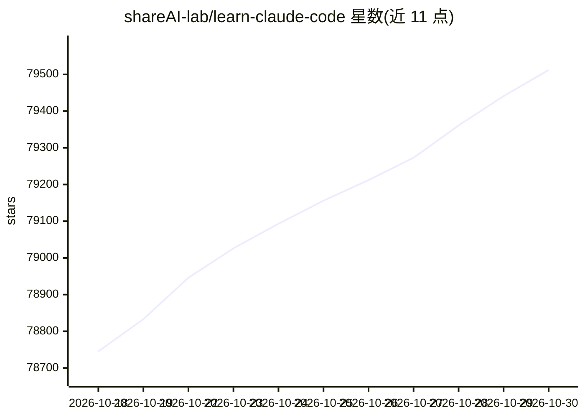

# shareAI-lab/learn-claude-code

⭐ 79,512 · Python · MIT · 推送 2026-10-27 · [GitHub](https://github.com/shareAI-lab/learn-claude-code) · [官网](https://learn.shareai.run) · 组织维护 · 中文 README

**教学仓库：从 0 到 1 构建类 Claude Code 的 agent harness**

一个 harness 工程教学课程，用 Python 从零实现类 Claude Code 的 agent 运行时，分 17 个递进章节，每章只讲一个机制：agent loop、工具注册、权限、hooks、TodoWrite、subagent、技能按需加载、上下文压缩、记忆、文件任务系统、后台任务、定时任务、MCP、多 agent 团队等。核心论点是「智能来自模型，工程者的工作是构建 harness」。每章含英/中/日三语 README 与可运行 code.py。属教学材料，非生产框架。

## 筛选速览

| 维度 | 判定 | 备注 |
|---|---|---|
| AI 角色 | `ai-ecosystem` | LLM/agent 周边工具 |
| 许可风险 | `permissive` | MIT |
| 部署形态 | `library` | 以包/库形式分发 |
| 模型依赖 | — | README 未给出锁定关系 |
| 硬件要求 | — | 无带数字的原话,不猜 |
| 安装摩擦 | `low` | 无编译、无系统依赖或容器化 |
| 成熟度 | — | 结构信号不足 |

## 动量与使用信号

- 维护:`active` — 距上次 push 19.7 天,年发版 0,43 位贡献者
- 涨星:近 1 天 **+65**(自 20261016 起算)
- 安装:npm 包 `@shareai-lab/kode` 月下载 403
- 平台:— · 协议:MCP

## 能力要点

- 17 个递进章节，每章实现一个 harness 机制并提供可运行 code.py
- 以单一 agent loop 为核心，工具经 dispatch map 注册
- README 提供英文、中文、日文三语版本
- 保留 legacy 12 课版本并提供新旧章节映射表

## 适用场景

- 想理解 Claude Code 类工具内部机制的开发者逐课跟学
- 按章节动手实现自己的 agent loop 与工具系统
- 用 s01-s17 章节作为 agent 工程教学材料

## 场景标签

`教程课程` `多智能体` · 领域:Agent 开发

## 证据(README 行号)

> L5: # Learn Claude Code -- Harness Engineering for Real Agents
> L124:  The root-level `s01_*` ... `s17_*` folders are the canonical version. Each chapter contains an English default RE
> L156: > **s01** &nbsp; *"One loop & Bash is all you need"* &mdash; one tool + one loop = one agent

## 星数曲线

2026-10-18 78,745 → 2026-10-30 79,512（+767）

---
*卡片 v1 · prompt 1.4 · 生成 2026-10-18 · 置信度 low · 依据 README sha `4c3cce1762c9` · [字段定义](../../DATASET.md)*
