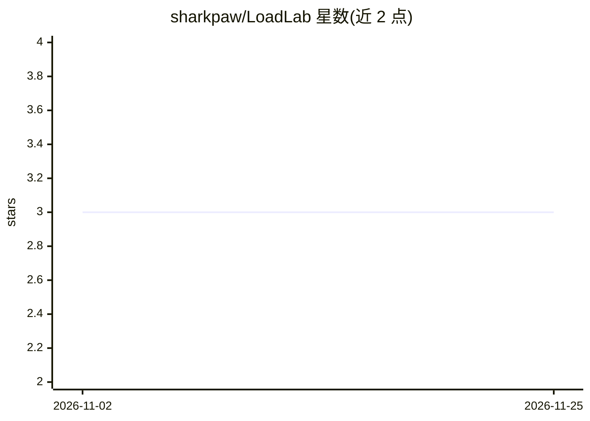

# sharkpaw/LoadLab

⭐ 3 · TypeScript · Apache-2.0 · 推送 2026-11-04 · [GitHub](https://github.com/sharkpaw/LoadLab) · 个人维护

**自托管的 k6 负载测试平台：AI agent 可通过 MCP 起草测试**

基于 k6 引擎的自托管负载测试平台：通过可视化流程编辑器建模真实用户路径（概率、循环、变量、共享模块），支持冒烟/恒定/Ramp-up/Stress/Spike/Soak/Breakpoint 等测试档型，实时查看 p50/p95/p99 与错误率图表，按站点保留基准历史以追踪回归。k6 运行统一的通用脚本解析工作流 JSON，不按测试生成代码，支持多 worker 分布式拆分。AI agent 通过 MCP 检查站点、起草工作流与测试计划并读取结果，草稿需人工审核后启动。

## 筛选速览

| 维度 | 判定 | 备注 |
|---|---|---|
| AI 角色 | `ai-enhanced` | 去掉 AI 部分产品仍成立 |
| 许可风险 | `permissive` | Apache-2.0 |
| 部署形态 | `self-host` | docker 或自建部署 |
| 模型依赖 | — | README 未给出锁定关系 |
| 硬件要求 | — | 无带数字的原话,不猜 |
| 安装摩擦 | `low` | 无编译、无系统依赖或容器化 |
| 成熟度 | — | 结构信号不足 |

## 能力要点

- 可视化流程编辑器建模用户旅程，含 HAR 导入与浏览器工作流
- Breakpoint 测试自动加压至 p95 或错误率越限，报告最高健康吞吐
- 暴露 25 个 MCP 工具，agent 创建内容以草稿形式等待审核
- 按站点保留基准历史，可对比运行并标记基线

## 适用场景

- 压测自己负责的站点并找出承载上限
- 录制浏览器操作生成负载测试工作流草案
- 通过 Claude 或 Cursor 让 AI 代为起草测试计划并分析结果
- 定期夜间基准测试追踪性能回归

## 场景标签

 · 领域:开发运维/性能测试

## 证据(README 行号)

> L8: A self-hosted load-testing platform built on k6: model real user journeys, run them at any scale, watch results live
> L28: - 🤖 **Built for AI agents (MCP).** Claude, Gemini, ChatGPT, Cursor or any other MCP client can inspect your site, d
> L138: LoadLab exposes 25 tools: inspect a page, create, update or debug workflows, draft test plans, read run results an

## 星数曲线

2026-11-02 3 → 2026-11-25 3（+0）

---
*卡片 v1 · prompt 1.4 · 生成 2026-11-21 · 置信度 high · 依据 README sha `99a65d76dc37` · [字段定义](../../DATASET.md)*
