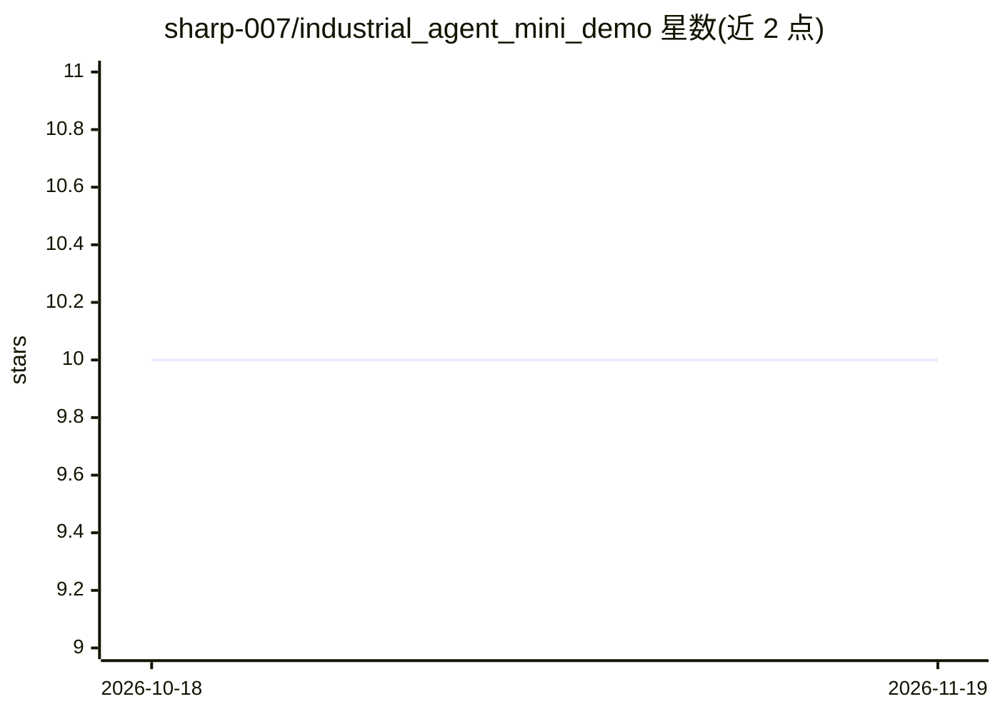

# sharp-007/industrial_agent_mini_demo

⭐ 10 · Python · 推送 2026-07-19 · [GitHub](https://github.com/sharp-007/industrial_agent_mini_demo) · [官网](https://github.com/sharp-007/industrial_agent_mini_demo) · 个人维护 · 中文 README

**基于私有 PDF 文档做 RAG 问答的工业维护知识库演示**

一个最小可运行（MVP）的工业设备维护知识库问答演示项目：上传 PDF 后经文本分块、Qwen Embedding 向量化并存入 ChromaDB，用户提问时按向量相似度检索文档片段，交给所选 LLM 生成回答，并显示参考来源、页码与相关度评分。前后端分离：后端 FastAPI，前端 React 18 + Vite 聊天界面。LLM 可通过环境变量切换 Qwen / DeepSeek / OpenAI / Ollama 本地模型。以 conda 环境手动启动前后端方式运行，需自备 API Key。

## 筛选速览

| 维度 | 判定 | 备注 |
|---|---|---|
| AI 角色 | `ai-native` | 本体是模型或模型工具 |
| 许可风险 | `none` | — |
| 部署形态 | `None` |  |
| 模型依赖 | local-ok | 支持本地模型 |
| 硬件要求 | — | 无带数字的原话,不猜 |
| 安装摩擦 | `low` | 无编译、无系统依赖或容器化 |
| 成熟度 | — | 结构信号不足 |

## 能力要点

- PDF 上传→分块→向量化→ChromaDB 存储的完整 RAG 流程
- 回答附带参考来源、页码与相关度评分
- 通过 LLM_PROVIDER 环境变量在 Qwen/DeepSeek/OpenAI/Ollama 间切换
- 提供 /upload、/query、/clear 等 REST API 接口

## 适用场景

- 把设备手册、维护指南等 PDF 导入后进行问答
- 在本地内网环境用 Ollama 离线运行知识库问答
- 作为学习 RAG 系统搭建的演示工程

## 场景标签

`文档问答` `RAG` · 领域:知识与检索

## 证据(README 行号)

> L5: 一个最小可运行（MVP）级的工业设备维护知识库 AI 演示项目，采用 **RAG (Retrieval-Augmented Generation)** 技术，让大语言模型基于你的私有文档进行精准问答。
> L26: - 📄 **PDF 文档处理** - 上传设备手册、维护指南等 PDF 文档，自动分块和向量化
> L54: |**ChromaDB**|向量数据库（本地持久化）|

## 星数曲线

2026-10-18 10 → 2026-11-19 10（+0）

---
*卡片 v1 · prompt 1.4 · 生成 2026-11-19 · 置信度 high · 依据 README sha `f747ec5161bf` · [字段定义](../../DATASET.md)*
