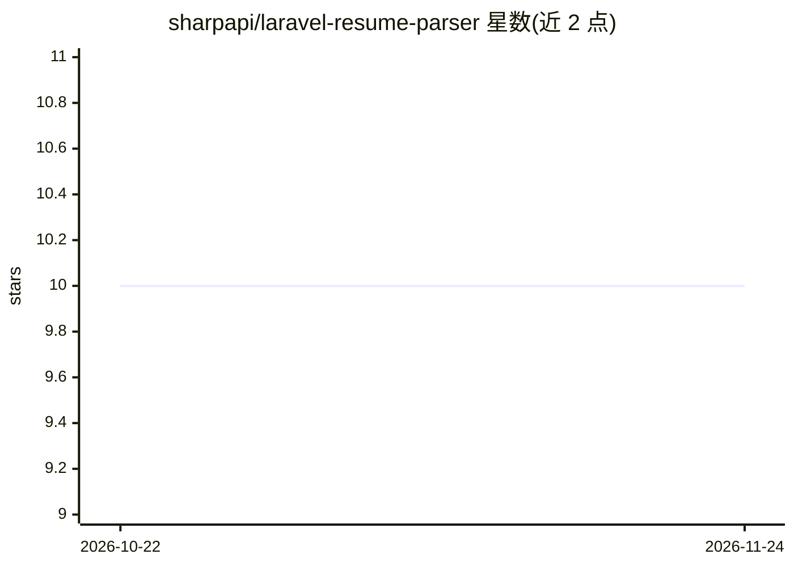

# sharpapi/laravel-resume-parser

⭐ 10 · PHP · MIT · 推送 2026-09-24 · [GitHub](https://github.com/sharpapi/laravel-resume-parser) · [官网](https://sharpapi.com/en/catalog/ai/hr-tech/resume-cv-parsing) · 组织维护

**为 Laravel 应用接入简历解析与数据提取的 PHP 包**

基于 SharpAPI 云端 API 的 Laravel 简历解析包：通过 composer 安装后注入 ResumeParserService，将 DOC/DOCX/PDF/图片等 11 种格式的简历发送到 API，任务采用派发-轮询模式获取结果，输出固定 JSON 结构的解析数据，支持 80+ 种语言与扁平化 PDF（纯图片型）。依赖 SharpAPI.com 的 API key 与订阅配额，提供 ping/quota 端点检查可用性，建议配合 Laravel 队列做批处理，并附带 Laravel Boost 的 agent 技能资源。

## 筛选速览

| 维度 | 判定 | 备注 |
|---|---|---|
| AI 角色 | `ai-native` | 本体是模型或模型工具 |
| 许可风险 | `permissive` | MIT |
| 部署形态 | `None` |  |
| 模型依赖 | — | README 未给出锁定关系 |
| 硬件要求 | — | 无带数字的原话,不猜 |
| 安装摩擦 | `low` | 无编译、无系统依赖或容器化 |
| 成熟度 | — | 结构信号不足 |

## 能力要点

- 支持 11 种简历文件格式，包括纯图片型扁平 PDF
- 解析结果以固定 JSON 结构返回，支持 80+ 种语言
- 轮询式异步任务处理，可配合 Laravel 队列批处理
- 附带 Laravel Boost agent 技能资源（需 Boost 2+）

## 适用场景

- HR Tech 应用中批量提取简历的结构化字段
- 将各类格式的简历统一转成 JSON 数据入库
- 在 Laravel 项目中以服务注入方式调用简历解析

## 场景标签

`文档解析` · 领域:知识与检索

## 证据(README 行号)

> L47: - **Automated Resume Parsing with AI**: Efficiently parse and extract structured information from resumes in variou
> L59: 1. **Dispatch Job**: Send a resume file to the API using `parseResume`, which returns a status URL.

## 星数曲线

2026-10-22 10 → 2026-11-24 10（+0）

---
*卡片 v1 · prompt 1.4 · 生成 2026-11-19 · 置信度 mid · 依据 README sha `68d7ac7f1cd1` · [字段定义](../../DATASET.md)*
