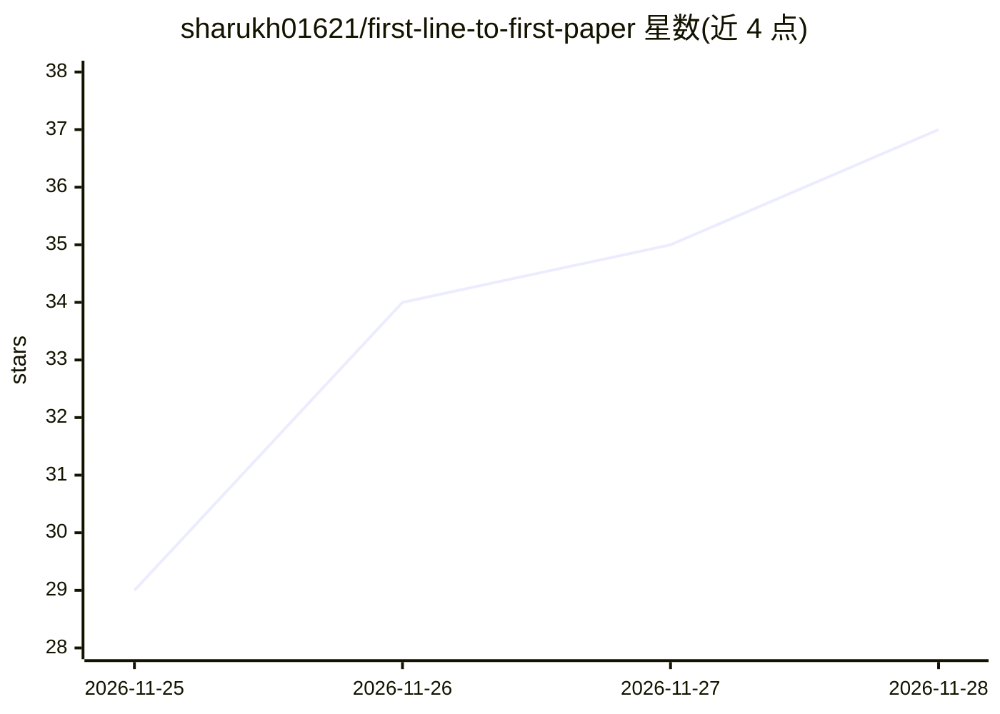

# sharukh01621/first-line-to-first-paper

⭐ 37 · Jupyter Notebook · NOASSERTION · 推送 2026-11-24 · [GitHub](https://github.com/sharukh01621/first-line-to-first-paper) · [官网](https://sharukh01621.github.io/first-line-to-first-paper/) · 个人维护

**面向零基础量化学习者的 860 页 Python/统计/深度学习教材**

860 页、36 章的零基础到科研级教科书，与 182 个 Google Colab 笔记本一一配对，覆盖 Python、生物统计、经典机器学习与 PyTorch 深度学习，直至可复现研究与论文写作。配套 sharukh-tutor 辅导工具提供三级渐进提示与 324 项自动诊断检查；每章遵循 8 阶段掌握弧，所有笔记本在指定版本栈（Python 3.12、PyTorch 2.15 等）下经零漂移验证。文本与代码分别采用 CC BY-NC-SA 与独立代码许可。

## 筛选速览

| 维度 | 判定 | 备注 |
|---|---|---|
| AI 角色 | `ai-knowledge` | 知识聚合/清单类 |
| 许可风险 | `none` | NOASSERTION |
| 部署形态 | `library` | 以包/库形式分发 |
| 模型依赖 | — | README 未给出锁定关系 |
| 硬件要求 | — | 无带数字的原话,不猜 |
| 安装摩擦 | `low` | 无编译、无系统依赖或容器化 |
| 成熟度 | — | 结构信号不足 |

## 能力要点

- 860 页 36 章教材与 182 个 Colab 交互笔记本一一配对
- sharukh-tutor 提供 972 条三级渐进提示与自动诊断检查
- 全程锚定公共卫生/流行病学合成数据集
- 笔记本构建与 182 个 QA 验证流水线可本地运行

## 适用场景

- 从零学习 Python 并逐步进入统计与深度学习
- 生物统计/公共卫生研究者补齐机器学习技能
- 通过编码考试与辅导提示自测掌握程度

## 场景标签

`教程课程` `科研工具` · 领域:学习与行业

## 证据(README 行号)

> L25: ***From First Line to First Paper*** is an **860-page, 36-chapter** zero-to-researcher textbook paired **1-to-1** w
> L27: Designed with **zero prior coding prerequisites**, the book guides quantitative students, biostatisticians, public 

## 星数曲线

2026-11-25 29 → 2026-11-28 37（+8）

---
*卡片 v1 · prompt 1.4 · 生成 2026-11-24 · 置信度 mid · 依据 README sha `7debf5632fa7` · [字段定义](../../DATASET.md)*
