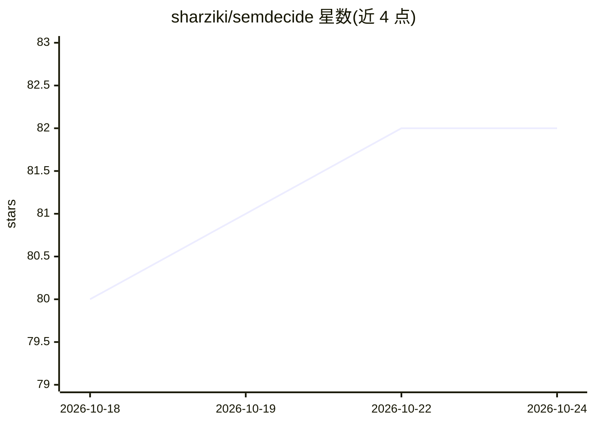

# sharziki/semdecide

⭐ 81 · Python · MIT · 推送 2026-09-16 · [GitHub](https://github.com/sharziki/semdecide) · 个人维护

**Unix 管道用的语义判定 CLI：文本进、谓词/路由/评分/过滤出**

面向脚本与 CI 的命令行工具，调用 TypeSafe AI 的 Jev 模型返回类型化决策：is 语义谓词、choose 选项路由、score 等级评分、filter JSONL 语义过滤、guard 动作安全审查（allow/escalate/block）。输出含概率与置信度，遵循 grep 式退出码并区分不确定与提供方失败；提供阈值、超时、重试与输入上限控制。运行时零依赖，输入会发送至 TypeSafe AI，需设置其 API key；文档声明非官方产品。

## 筛选速览

| 维度 | 判定 | 备注 |
|---|---|---|
| AI 角色 | `ai-native` | 本体是模型或模型工具 |
| 许可风险 | `permissive` | MIT |
| 部署形态 | `library` | 以包/库形式分发 |
| 模型依赖 | — | README 未给出锁定关系 |
| 硬件要求 | — | 无带数字的原话,不猜 |
| 安装摩擦 | `low` | 无编译、无系统依赖或容器化 |
| 成熟度 | — | 结构信号不足 |

## 能力要点

- is/choose/score/filter/guard 五个子命令产出类型化语义决策
- grep 式退出码，将不确定（3）与提供方失败（4）与真/假区分
- guard 食谱：Jev 评估授权/破坏性等信号，本地确定性代码返回 allow/escalate/block，失败 fail-closed
- 运行时零依赖，输入校验拒绝空/二进制/超限内容

## 适用场景

- 在 shell 管道中按语义过滤 JSONL 工单流
- CI 中判断变更是否引入破坏性 API 行为并据退出码分支
- agent 执行动作前的 allow/escalate/block 审查

## 场景标签

 · 领域:开发者工具/LLM 判定

## 证据(README 行号)

> L5: SemDecide is `grep` for meaning and `jq` for judgment. Pipe in text or JSONL and get a predicate, route, score, filt
> L27: Jev returns typed decisions instead. SemDecide gives those decisions predictable Unix input, output, limits, retrie

## 星数曲线

2026-10-18 80 → 2026-10-24 82（+2）

---
*卡片 v1 · prompt 1.4 · 生成 2026-10-24 · 置信度 mid · 依据 README sha `46098495fda2` · [字段定义](../../DATASET.md)*
