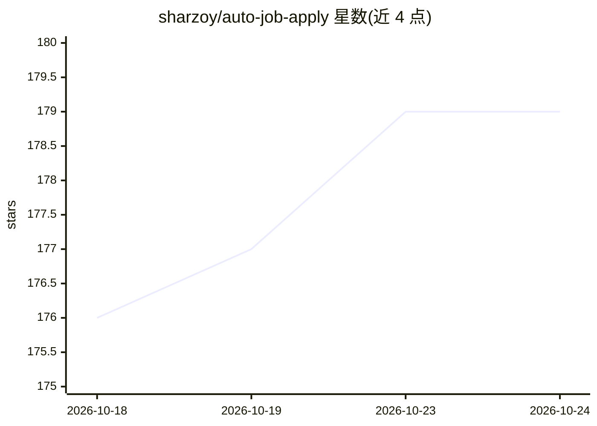

# sharzoy/auto-job-apply

⭐ 179 · Python · MIT · 推送 2026-08-18 · [GitHub](https://github.com/sharzoy/auto-job-apply) · 个人维护 · 中文 README

**AI 求职助手 Skill：简历解析、JD 匹配打分、生成投递包**

基于 AI Agent 的求职辅助 Skill（面向 Cursor Agent 运行）：读取简历提取能力，核对 JD 硬性要求（学历/年限等），按加权维度（方向25+技能25+年限15等）输出 A/B/C 匹配评分，硬性未过则强制降级；随后生成含打招呼话术、HR 视角模拟、简历修改建议的投递包文件。设计上保留人工确认环节，支持 Boss 直聘、前程无忧、智联、公司站、邮件等平台约定，不进行无人值守批量投递；附带本地 Python 脚本统计投递量与回复率。

## 筛选速览

| 维度 | 判定 | 备注 |
|---|---|---|
| AI 角色 | `ai-native` | 本体是模型或模型工具 |
| 许可风险 | `permissive` | MIT |
| 部署形态 | `None` |  |
| 模型依赖 | — | README 未给出锁定关系 |
| 硬件要求 | — | 无带数字的原话,不猜 |
| 安装摩擦 | `low` | 无编译、无系统依赖或容器化 |
| 成熟度 | — | 结构信号不足 |

## 能力要点

- A/B/C 匹配评分体系，JD 硬性要求未过强制降级（防误判）
- 生成投递包：摘要卡、打招呼话术、HR 视角模拟、简历修改建议
- 人工确认门闩：预览→用户指令→才提交；C 级需强制投递
- 本地 Python 脚本统计投递量与回复率

## 适用场景

- 投递前核对 JD 硬性条件并获得匹配评分
- 生成针对具体岗位的打招呼话术与简历优化建议
- 从 HR 视角预演面试疑虑与可能的淘汰原因

## 场景标签

`AI 助手` · 领域:对话与助手

## 证据(README 行号)

> L5: 一个基于 AI Agent 的求职辅助 Skill，帮助用户从职位分析到投递准备完成完整流程：
> L10: - 💬 自动生成 Boss/前程无忧沟通话术
> L11: - 🎤 HR 视角模拟面试与简历优化建议

## 星数曲线

2026-10-18 176 → 2026-10-24 179（+3）

---
*卡片 v1 · prompt 1.4 · 生成 2026-10-22 · 置信度 high · 依据 README sha `1c40f9d61067` · [字段定义](../../DATASET.md)*
