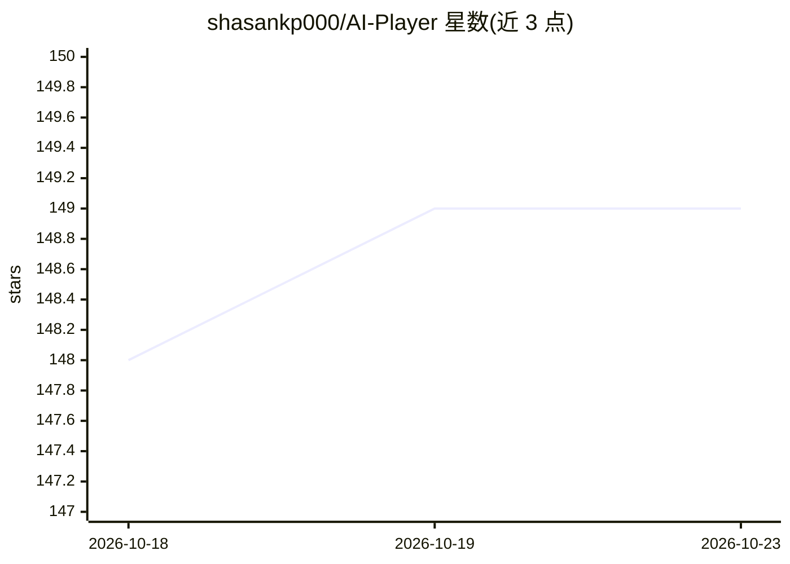

# shasankp000/AI-Player

⭐ 149 · Java · GPL-2.0 · 推送 2026-09-21 · [GitHub](https://github.com/shasankp000/AI-Player) · [官网](https://shasankp000.github.io/AI-Player-Website/) · 个人维护

**Minecraft 模组：添加可对话、可自主行动的 AI 伙伴玩家**

Fabric 平台的 Minecraft 模组，在游戏中生成一个由 LLM 驱动的服务端“第二玩家”：支持自然语言对话（自研 NLP 管线）、目标规划与自主任务分配、跟随与外出探险、物品交易，以及受玩家行为与世界事件影响的情绪/人设系统。兼容任意 OpenAI API 兼容提供方（OpenRouter、TogetherAI、Groq、LM Studio、llama.cpp 等），Ollama 非必需；集成带网络搜索的 RAG 系统以提供 Minecraft 事实信息。依赖 Carpet 模组内部代码，作者独立维护，进度自标 75.5%。

## 筛选速览

| 维度 | 判定 | 备注 |
|---|---|---|
| AI 角色 | `ai-native` | 本体是模型或模型工具 |
| 许可风险 | `viral` | GPL-2.0 |
| 部署形态 | `None` |  |
| 模型依赖 | local-ok | 支持本地模型 |
| 硬件要求 | — | 无带数字的原话,不猜 |
| 安装摩擦 | `medium` | 含编译或系统依赖之一 |
| 成熟度 | `idea` | |

## 能力要点

- 服务端 AI 玩家：对话、自主目标、跟随、交易
- 兼容任意 OpenAI API 兼容提供方，支持 LM Studio / llama.cpp 本地模型
- 带网络搜索（Gemini/Serper API）的 RAG 系统降低幻觉
- 情绪与人设系统受玩家行为和世界事件动态影响

## 适用场景

- 单人游戏时有个 AI 伙伴陪我聊天和一起探险
- 用本地运行的 LLM 驱动游戏内 AI 玩家
- 让 AI 伙伴自主接任务、采集和交易物品

## 场景标签

`聊天机器人` · 领域:对话与助手

## 证据(README 行号)

> L38: A minecraft mod which aims to add a "second player" into the game which will actually be intelligent.
> L87: An autonomous self goal assignment system for the bot, it gives the bot "quests" to do, so that it automatically mo
> L95: AI-Player no longer requires ollama to be exclusively used and installed, instead it's now compatible with any Open

## 星数曲线

2026-10-18 148 → 2026-10-23 149（+1）

---
*卡片 v1 · prompt 1.4 · 生成 2026-10-22 · 置信度 high · 依据 README sha `a1593ab044a1` · [字段定义](../../DATASET.md)*
