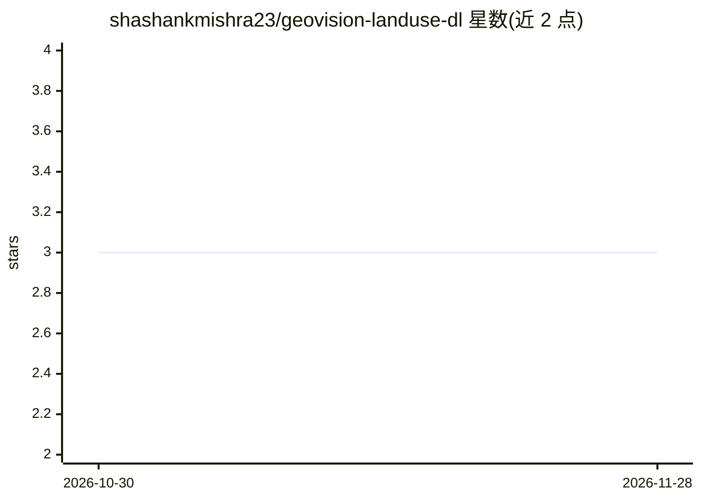

# shashankmishra23/geovision-landuse-dl

⭐ 3 · Python · MIT · 推送 2026-10-28 · [GitHub](https://github.com/shashankmishra23/geovision-landuse-dl) · 组织维护

**卫星图像土地利用分类项目：训练、可解释、API 部署与漂移监控**

基于 EuroSAT 数据集的端到端深度学习项目：27,000 张 Sentinel-2 图像微调 EfficientNet-B0 做 10 类土地利用分类（4,050 张测试图像上准确率 94.5%），附带 Grad-CAM 热力图解释、FastAPI Web 应用（拖拽上传、批量处理、CSV 导出）、噪声校正 PSI 漂移监控与人工反馈端点。模型权重包含在 artifacts/ 中无需重新训练即可运行；作者在 README 声明局限性：仅 CPU 64px 训练 5 epochs、校准指标未达目标、欧洲数据训练需按区域微调。

## 筛选速览

| 维度 | 判定 | 备注 |
|---|---|---|
| AI 角色 | `ai-native` | 本体是模型或模型工具 |
| 许可风险 | `permissive` | MIT |
| 部署形态 | `self-host` | docker 或自建部署 |
| 模型依赖 | — | README 未给出锁定关系 |
| 硬件要求 | — | 无带数字的原话,不猜 |
| 安装摩擦 | `low` | 无编译、无系统依赖或容器化 |
| 成熟度 | — | 结构信号不足 |

## 能力要点

- EfficientNet-B0 在 27,000 张 Sentinel-2 图像上微调，10 类分类，测试准确率 94.5%
- Grad-CAM 热力图解释每次预测的像素依据
- 噪声校正 PSI 漂移监控，输入图像变暗时触发告警
- FastAPI REST 服务、ONNX 导出、Dockerfile 与 20 个自动化测试

## 适用场景

- 对卫星图像瓦片做土地利用分类并导出批量结果
- 查看每条预测的 Grad-CAM 解释热力图
- 监控线上输入分布漂移并记录人工标注的准确率

## 场景标签

`目标检测` `微调` `MLOps` · 领域:感知与多模态

## 证据(README 行号)

> L13: **Classify satellite images into 10 land-use classes, see *why* the model decided, and get alerted when live data d
> L26: |🛰️|**Land-use classification**|EfficientNet-B0 fine-tuned on 27,000 Sentinel-2 tiles, 10 classes|
> L31: |⚡|**Production API**|FastAPI REST service, ONNX export (4.7× faster on CPU), Dockerfile|

## 星数曲线

2026-10-30 3 → 2026-11-28 3（+0）

---
*卡片 v1 · prompt 1.4 · 生成 2026-11-21 · 置信度 high · 依据 README sha `a3648ee27c91` · [字段定义](../../DATASET.md)*
