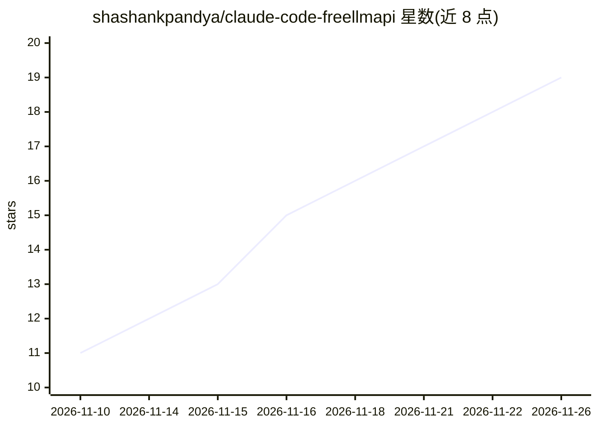

# shashankpandya/claude-code-freellmapi

⭐ 19 · MIT · 推送 2026-08-17 · [GitHub](https://github.com/shashankpandya/claude-code-freellmapi) · 个人维护

**让 Claude Code 经 FreeLLMAPI+LiteLLM 运行的配置指南仓库**

文档型仓库：记录如何在 Windows 上搭建 Claude Code → LiteLLM → FreeLLMAPI 的桥接架构。Claude Code 需要 Anthropic 风格请求语义，而 FreeLLMAPI 是 OpenAI 兼容网关，LiteLLM 作为翻译层完成格式转换，请求最终转发到本地/远程模型池。提供 PowerShell 启动脚本、测试提示词、安装/验证/故障排查指南。仓库本身为文档与脚本集合，需另行安装 Python、Node.js 及各组件依赖。

## 筛选速览

| 维度 | 判定 | 备注 |
|---|---|---|
| AI 角色 | `ai-ecosystem` | LLM/agent 周边工具 |
| 许可风险 | `permissive` | MIT |
| 部署形态 | `library` | 以包/库形式分发 |
| 模型依赖 | — | README 未给出锁定关系 |
| 硬件要求 | — | 无带数字的原话,不猜 |
| 安装摩擦 | `low` | 无编译、无系统依赖或容器化 |
| 成熟度 | — | 结构信号不足 |

## 能力要点

- Claude Code→LiteLLM→FreeLLMAPI 三层网关架构文档
- 提供 combined-startup.ps1 等一键启动脚本与测试提示词
- 覆盖 Windows 安装、验证与故障排查指南

## 适用场景

- 在 Windows 上复现 Claude Code + FreeLLMAPI + LiteLLM 的完整桥接
- 验证网关转发链路是否正常工作
- 排查 Anthropic 与 OpenAI 兼容格式之间的转换问题

## 场景标签

 · 领域:LLM 基础设施/兼容性桥接

## 证据(README 行号)

> L18: LiteLLM acts as the translation layer between the Anthropic-style client and the OpenAI-compatible gateway.
> L24: This repository provides a complete guide for setting up Claude Code with FreeLLMAPI and LiteLLM as a compatibility
> L43: 2. **LiteLLM**: Acts as a compatibility bridge, translating requests from Claude Code to a format that FreeLLMAPI c

## 星数曲线

2026-11-10 11 → 2026-11-26 19（+8）

---
*卡片 v1 · prompt 1.4 · 生成 2026-11-18 · 置信度 mid · 依据 README sha `6e6a8f48cb9f` · [字段定义](../../DATASET.md)*
