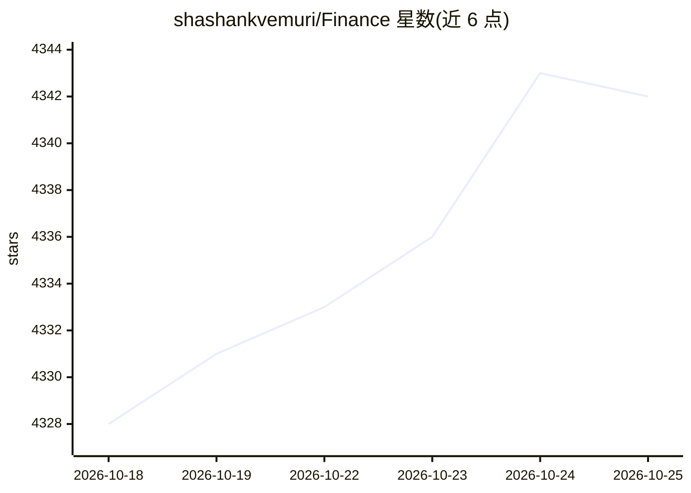

# shashankvemuri/Finance

⭐ 4,343 · Python · MIT · 推送 2026-09-12 · [GitHub](https://github.com/shashankvemuri/Finance) · 个人维护

**量化金融 Python 工具库：行情数据、指标、回测与组合优化**

面向量化研究者的 Python 工具库，覆盖市场数据下载（Yahoo/Finviz/财报等）、技术指标计算、选股筛选、策略回测（次开盘执行、多空、佣金滑点）、组合优化与统计建模。核心依赖仅 NumPy 与 pandas，通过可选 extras 按需启用数据、模型、图表等模块；ML/神经网络与 Prophet 为可选实验。声明快照数据非历史点时数据，预测实验仅报告留出误差、不宣称预测优势，仅作教育用途。

## 筛选速览

| 维度 | 判定 | 备注 |
|---|---|---|
| AI 角色 | `ai-enhanced` | 去掉 AI 部分产品仍成立 |
| 许可风险 | `permissive` | MIT |
| 部署形态 | `library` | 以包/库形式分发 |
| 模型依赖 | — | README 未给出锁定关系 |
| 硬件要求 | — | 无带数字的原话,不猜 |
| 安装摩擦 | `low` | 无编译、无系统依赖或容器化 |
| 成熟度 | — | 结构信号不足 |

## 能力要点

- 离线技术指标计算，无需网络访问
- 回测器跟踪现金、碎股、多空成交、佣金、滑点与借券成本
- 核心依赖仅 NumPy/pandas，功能按 extras 按需安装
- 可选统计/ML 实验（ARIMA、PCA、聚类、神经网络、Prophet）

## 适用场景

- 研究并回测均线交叉等技术策略
- 做组合优化与资产配置模拟
- 用 Finviz/相对强度等规则做股票筛选

## 场景标签

`金融量化` · 领域:学习与行业

## 证据(README 行号)

> L24: python -m pip install -e '.[portfolio,models]' # Optimization and statistical/ML experiments
> L74: |`models`|Forecasts/baselines, ARIMA diagnostics, PCA/factors, regimes, clustering, networks and optional neural/Pr
> L92: Forecast experiments report held-out errors against simple baselines and make no claim of

## 星数曲线

2026-10-18 4,328 → 2026-10-25 4,342（+14）

---
*卡片 v1 · prompt 1.4 · 生成 2026-10-20 · 置信度 low · 依据 README sha `ac940a857eeb` · [字段定义](../../DATASET.md)*
