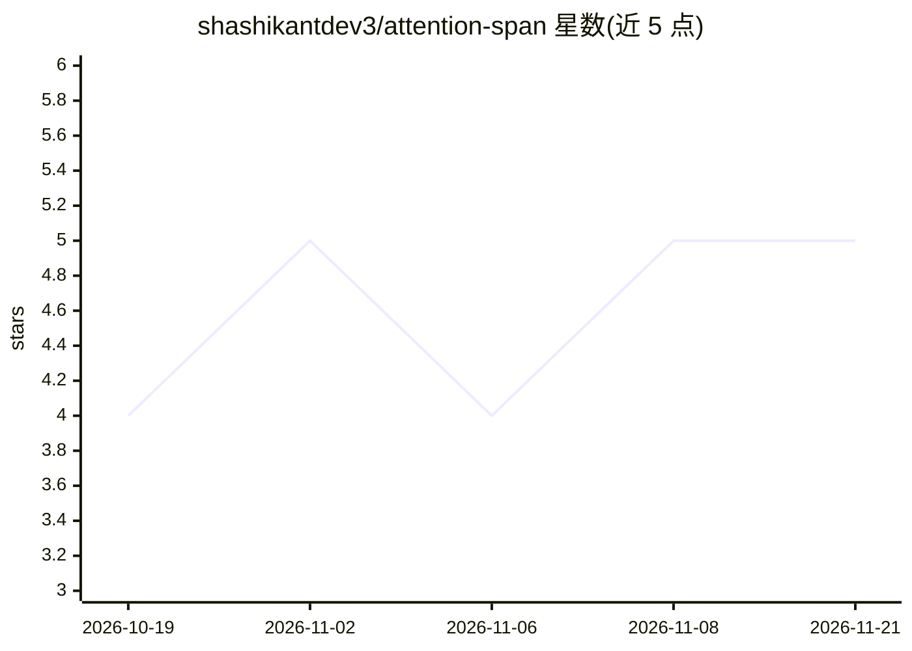

# shashikantdev3/attention-span

⭐ 5 · Python · MIT · 推送 2026-11-19 · [GitHub](https://github.com/shashikantdev3/attention-span) · [官网](https://shashikantdev3.github.io/attention-span/) · 个人维护

**每日 AI 新闻简报生成器：事实核查并溯源到出处**

一个每天运行两次的 AI 新闻简报流水线：从 40 个来源收集过去 24 小时的消息，用 TF-IDF 去重分组，由 Gemini Flash/Claude 选稿和写稿，再用另一族模型（Claude/Groq）加代码校验每个数字是否出现在原文中，未通过的故事重写一次后丢弃。附带 1943 年以来的 AI 历史时间线、带谱系的概念词表、实验室与人物页面，发布为 GitHub Pages 静态站点。依赖各家 API key（一个即可启动，缺失时自动切换下一家）。

## 筛选速览

| 维度 | 判定 | 备注 |
|---|---|---|
| AI 角色 | `ai-native` | 本体是模型或模型工具 |
| 许可风险 | `permissive` | MIT |
| 部署形态 | `library` | 以包/库形式分发 |
| 模型依赖 | locked-api |  |
| 硬件要求 | — | 无带数字的原话,不猜 |
| 安装摩擦 | `low` | 无编译、无系统依赖或容器化 |
| 成熟度 | — | 结构信号不足 |

## 能力要点

- 选稿/写稿/事实核查由不同模型族交叉执行，数字须在原文中出现
- 40 个来源 + 代码信号评分（HN 热度、独立来源数、行业转折措辞）辅助选稿
- 同一索引标签贯穿新闻/历史/概念/人物，各栏目互为过滤器
- 缓存与 --resume 支持中断后恢复且不重复消耗配额

## 适用场景

- 每天自动生成一份经过事实核查的 AI 新闻简报
- 查阅带谱系关系的 AI 概念词表与历史时间线
- 跟踪 51 位 AI 领域人物近七天的公开发言

## 场景标签

`知识图谱` · 领域:知识与检索

## 证据(README 行号)

> L5: A daily AI news bulletin with a memory. Every story is tagged with the same index as a source-checked history of AI
> L44: 3. **Edit**: one call to Gemini Flash picks up to 12 stories that matter to builders (Claude Sonnet if both Flash
> L53: 5. **Fact-check** with a different model family (Claude Sonnet, falling back to Groq gpt-oss-120b) and with code:

## 星数曲线

2026-10-19 4 → 2026-11-21 5（+1）

---
*卡片 v1 · prompt 1.4 · 生成 2026-11-21 · 置信度 high · 依据 README sha `44e9cf3f5ac2` · [字段定义](../../DATASET.md)*
