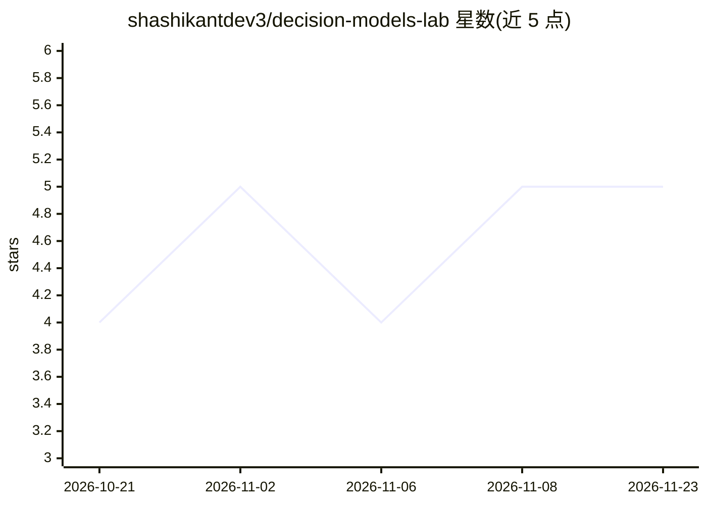

# shashikantdev3/decision-models-lab

⭐ 5 · TypeScript · MIT · 推送 2026-10-15 · [GitHub](https://github.com/shashikantdev3/decision-models-lab) · [官网](https://shashikantdev3.github.io/decision-models-lab/) · 个人维护

**边构建边学习决策模型的实验库：快速模型分诊+Claude 兜底**

一个通过动手构建来学习决策模型的教学实验项目：用 TypeSafe Jev 与 Microsoft Decision-1 在一次调用中对支持工单返回带概率的类型化答案（noul/choice/score 三类问题），低置信度工单升级给 Claude 做推理并起草回复，再由决策模型校验草稿。内置 48 张虚构工单的分诊演示、基准测试、措辞敏感性测试、校准指标（ECE）与交互式站点（Live/Replay/Mock 三模式），无 API key 也能离线运行。以 npm 安装的 Node 包加 Vite/React 站点形式提供。

## 筛选速览

| 维度 | 判定 | 备注 |
|---|---|---|
| AI 角色 | `ai-knowledge` | 知识聚合/清单类 |
| 许可风险 | `permissive` | MIT |
| 部署形态 | `library` | 以包/库形式分发 |
| 模型依赖 | locked-api |  |
| 硬件要求 | — | 无带数字的原话,不猜 |
| 安装摩擦 | `low` | 无编译、无系统依赖或容器化 |
| 成熟度 | `idea` | |

## 能力要点

- 决策模型+Claude 的升级流水线：decide、escalate、reason、verify 四步
- 基准与校准测试：macro-F1、MAE、ECE、延迟与成本记录
- Replay/Mock 模式离线运行，无需 API key
- 核心包可在 Node 与浏览器中复用（适配器、升级策略、指标）

## 适用场景

- 学习决策模型与聊天模型的差异及置信阈值的选择方法
- 搭建工单分诊：高置信度自动路由、低置信度交给推理模型
- 对同一问题的不同措辞做敏感性测试
- 在自己的 Node/浏览器应用中复用模型适配器与指标库

## 场景标签

`模型评测` `教程课程` · 领域:评测与运维

## 证据(README 行号)

> L3: Fast decisions with Jev and Decision-1, careful reasoning with Claude, and a clear rule for when to hand over.
> L51: ## What you will learn
> L53: - What a decision model is, and how it differs from asking a chat model.

## 星数曲线

2026-10-21 4 → 2026-11-23 5（+1）

---
*卡片 v1 · prompt 1.4 · 生成 2026-11-21 · 置信度 high · 依据 README sha `c4593c56da6e` · [字段定义](../../DATASET.md)*
